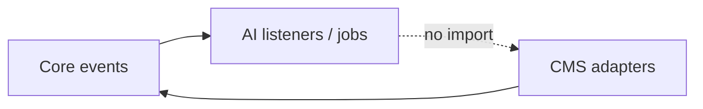

<p>&nbsp;</p>
<p align="center">
	<a href="https://github.com/getlaraplate" target="_blank">
		
    </a>
</p>
<p>&nbsp;</p>
<p align="center">
    
    
    
</p>
<p>&nbsp;</p>

# Laraplate AI Module

> ⚠️ **Caution**: This package is a **work in progress**. **Don't use this in production or use at your own risk**—no guarantees are provided... or better yet, collaborate with me to create the definitive Laravel boilerplate; that's the right place to introduce your ideas. Let me know your ideas...

## Table of Contents

-   [Description](#description)
-   [Installation](#installation)
-   [Configuration](#configuration)
-   [Features](#features)
-   [Architecture](#architecture)
-   [Scripts](#scripts)
-   [Contributing](#contributing)
-   [License](#license)

## Description

The AI Module provides artificial intelligence capabilities for embeddings generation, vector search, and automatic translation. This module is **optional** and can be activated/deactivated independently. When disabled, the application continues to function normally without AI features.

**Key Features:**
- ✨ Embeddings generation for vector search
- 🌐 Automatic translation (AI-powered and DeepL)
- 💬 AI Chat with conversation history and streaming
- 📚 RAG (Retrieval-Augmented Generation) for FAQ/documentation
- 🛠️ Assistant tools: reads under the user's permissions, writes as proposals the user confirms, figures, charts and relation maps as requests the backend emits and a client renders
- 🧠 Conversation memory with automatic summarization
- 🛡️ In-app assistance guardrails: policy, input and output limits, a deterministic injection classifier, tool results checked before the model reads them
- 🔄 Event-driven architecture for seamless integration
- 🎯 Zero dependencies from Core/Cms modules (Core never depends on AI)

## Installation

If you want to add this module to your project, you can use the `joshbrw/laravel-module-installer` package.

Add repository to your `composer.json` file:

```json
"repositories": [
    {
        "type": "composer",
        "url": "https://github.com/getlaraplate/laracore.git"
    },
    {
        "type": "composer",
        "url": "https://github.com/getlaraplate/laraai.git"
    }
]
```

```bash
composer require joshbrw/laravel-module-installer getlaraplate/laracore getlaraplate/laraai
```

Then, you can install the module by running the following command:

```bash
php artisan module:install Core
php artisan module:install AI
```

## Configuration

The AI module configuration is automatically mapped as `ai.*` when the module is active. Configuration file: `Modules/AI/config/config.php`.

Feature switches and tuning are runtime settings managed from Filament > Settings, not env vars: `features.{embeddings,translation,faq,contextual_suggestions,moderation}.enabled` (seeded off: they need a configured provider), `features.chat.enabled` (the in-app assistant, seeded off) and `features.chat.summary.enabled`, `features.faq.{max_documents,min_similarity,format_citations}`, `features.faq.read.rate_per_minute` (config only, default 120: the per-user limit of `GET /app/crud/detail/{module}/documentation`) and `features.faq.search.rate_per_minute` (config only, default 60: the per-user limit of `GET /app/crud/search/{module}/documentation`, the documentation passages of the command palette; see [docs/SEARCH_AND_TRANSLATION.md](docs/SEARCH_AND_TRANSLATION.md)), `features.faq.splitter.*`, the `features.moderation.*` thresholds and `features.moderation.queue` (the queue of the moderation jobs, read when a job is dispatched), `features.text_generation.{enabled,max_output_chars,cache_ttl_seconds}` and `features.text_generation.rate_limit.{max,per_seconds}` (seeded off, 500, 0, 60 and 60), `features.faq.vector_store` (`elasticsearch` or `filesystem`, seeded `elasticsearch`) and `features.faq.policy_classification_version` (seeded `in-app-docs-v1`), `features.media_analysis.enabled` (seeded off) and `features.media_analysis.near_duplicate_distance` (0 = off; see *Near-duplicate images*), the relevance judge `features.rag.judge.{enabled,max_rounds,min_sources,excerpt_chars}` and its model `features.rag.judge.model` (seeded off, 3, 3 and 600; see *Relevance judge*), `features.search_orchestration.enabled` and `features.search_orchestration.timeout` (seeded on and 10 seconds; see *Search modes and the AI overlay*), and the model of each AI feature, `features.*.model` (value `provider:model`, choices refreshed from the providers by `ai:models:refresh`, nightly or from the setting row; see `docs/rag/AI_MODEL_SELECTION_DEVELOPER.md`). Settings are listed without the module prefix (the module is a column) and read from config as `ai.<name>`. A value managed by a setting has no env variable: its default lives in code.

```env
# AI Features

# Embeddings: the provider and model are the setting `features.embeddings.model` (provider:model),
# no longer an env var. Configure the provider's key or URL (below); only configured profiles are offered.

# OpenAI Configuration
OPENAI_API_KEY=                      # OpenAI API key (optional with OPENAI_BASE_URL)
OPENAI_BASE_URL=                     # OpenAI-compatible server for chat, e.g. http://localhost:8080/v1 (llama.cpp); empty = api.openai.com
OPENAI_MODEL=                        # Model used by embeddings with OpenAI (AI features take their model from Settings)

# Ollama Configuration
OLLAMA_API_URL=                      # Ollama API URL, e.g. http://localhost:11434. Required to use Ollama: unset means not configured
OLLAMA_MODEL=llama3.2:3b            # Model used by embeddings with Ollama (AI features take their model from Settings)

# VoyageAI Configuration
VOYAGEAI_API_KEY=                    # VoyageAI API key
VOYAGEAI_MODEL=voyage-3-lite        # VoyageAI model

# Mistral Configuration
MISTRAL_API_KEY=                     # Mistral API key
MISTRAL_MODEL=mistral-large-latest  # Model used by embeddings with Mistral (AI features take their model from Settings)

# Servers for embeddings, reranking and transcription (docs/STANDARD_SERVERS_INSTALLATION.md)
AI_EMBEDDINGS_URL=                   # Root URL of the default embeddings server, without /v1 (TEI, Infinity, Ollama, LocalAI); unset = the profiles that use it are not offered
AI_EMBEDDINGS_API_KEY=               # Bearer key of that server (unset = no auth)
AI_EMBEDDINGS_TIMEOUT=30             # Per-request HTTP timeout in seconds (raise for slow CPU-bound servers)
AI_EMBEDDINGS_BATCH_SIZE=32          # Documents per request (a TEI refuses more than its --max-client-batch-size, 32 by default)
AI_RERANK_URL=                       # Reranker server (no built-in address; unset = no reranking)
AI_RERANK_API_KEY=                   # Its key
AI_RERANK_DIALECT=tei                # tei (POST /rerank {query, texts}) or cohere (Infinity, vLLM)
AI_RERANK_MODEL=                     # Model to rank with; required for cohere
AI_TRANSCRIPTION_URL=                # OpenAI-style POST /v1/audio/transcriptions server (speaches, LocalAI); unset = media index without a transcript
AI_TRANSCRIPTION_API_KEY=            # Its key
AI_TRANSCRIPTION_TIMEOUT=120         # Seconds a transcription request may take

# Embedding model switch
AI_EMBEDDINGS_INDEX_CHUNK_SIZE=250   # Records per IndexDocumentsChunkJob when a switch writes the search indexes (embeddings-index queue); below 1 or not a number: 250, capped at 2000
AI_EMBEDDINGS_RAG_CHUNK_SIZE=20     # Documentation files per IndexDocumentsChunkJob when a switch rebuilds the Elasticsearch documentation indexes; below 1 or not a number: 20, capped at 200
AI_EMBEDDINGS_INDEX_CHUNK_STALL_SECONDS=900  # A chunked switch phase fails, naming the queue, when embeddings-index holds jobs and no chunk was written for this long; below 1 or not a number: 900
AI_EMBEDDINGS_STATE_LOCK_WAIT_SECONDS=10     # Seconds a writer of the switch state waits for its lock before failing (the job is retried); below 1 or not a number: 10

# DeepL Configuration (for automatic translation)
DEEPL_API_KEY=                       # DeepL API key

# Optional Text Generation (answers Core's AiTextGenerationRequested event): the settings features.text_generation.* in Filament
# Live smoke test (tests/Integration/AiTextGenerationLiveSmokeTest.php) runs only with AI_LIVE_TESTS=1 + provider credentials.

# FAQ/RAG Configuration
AI_FAQ_DOCS_PATH=                    # Optional extra roots (comma/semicolon/newline); see docs/README.md and rag_paths()
# The vector store is the setting features.faq.vector_store in Filament (elasticsearch or filesystem)
AI_FAQ_VECTOR_STORE_PATH=            # Filesystem store file (default: storage/app/ai/faq-vectorstore.store); use shared volume in multi-instance
AI_FAQ_ES_INDEX=laraplate_rag_docs   # Elasticsearch index name when the vector store is elasticsearch
AI_FAQ_QUERY_LOG_INDEX=laraplate_rag_queries   # Elasticsearch index of the documentation query log (ai:create-rag-query-index); the switch, the question mode and the retention are the settings features.faq.query_logging.* in Filament
# (AI_FAQ_ES_EMBEDDING_DIMS was removed: the RAG vector length is the active embedding profile's `dimensions`)

```

Removed on 2026-09-29, now settings in Filament > Settings (see above): `AI_CHAT_PROVIDER`, `AI_TEXT_GENERATION_PROVIDER`, `AI_TEXT_GENERATION_MODEL`, `AI_MODERATION_PROVIDER`, `AI_COMMENT_MOD_PROVIDER`, `AI_SEARCH_ORCHESTRATION_PROVIDER`, `AI_TRANSLATION_PROVIDER`, `ANTHROPIC_MODEL`, `AI_MEDIA_ANALYSIS_ENABLED`, `AI_MEDIA_VISION_MODEL`, `AI_MEDIA_VISION_OLLAMA_MODEL`, `AI_MEDIA_TRANSCRIPTION_MODEL`, `AI_MEDIA_WHISPER_LOCAL_MODEL`.


Upgrade note: the in-app assistant has its own switch, `features.chat.enabled`, seeded off. Before it, the assistant answered whenever the AI module was active; an existing installation turns it on in Filament > Settings, group `ai`, once the next seed has created the setting. `features.faq.enabled` now only decides whether the assistant reads the user documentation.

Removed on 2026-10-07, now settings in Filament > Settings, group `ai`: `AI_TEXT_GENERATION_ENABLED`, `AI_TEXT_GENERATION_MAX_CHARS`, `AI_TEXT_GENERATION_CACHE_TTL`, `AI_TEXT_GENERATION_RATE_MAX`, `AI_TEXT_GENERATION_RATE_WINDOW` (`features.text_generation.*`), `AI_FAQ_VECTOR_STORE` (`features.faq.vector_store`), `AI_FAQ_POLICY_CLASSIFICATION_VERSION` (`features.faq.policy_classification_version`), `AI_MODERATION_QUEUE` and its fallback `AI_COMMENT_MOD_QUEUE` (`features.moderation.queue`). Removed with nothing in their place, since nothing read them or the code they drove is gone: `AI_TOOLS_ENABLED`, `AI_GUARDRAILS_ENABLED`, `AI_GUARDRAILS_PROMPT_INJECTION`, `AI_GUARDRAILS_JSON_VALIDATION`, `LAKERA_API_KEY`, `LAKERA_ENDPOINT`. `AI_EMBEDDINGS_ENABLED`, `AI_CHAT_ENABLE_SUMMARY`, the `AI_MODERATION_*` switches and the other `AI_COMMENT_*` variables are read by nothing: the switches are the settings `features.embeddings.enabled`, `features.chat.summary.enabled` and `features.moderation.*`.

### Embeddings and vector search

Three settings in Filament > Settings, group `ai`, drive vector search; there is no env variable for them
and Core has no `search.vector.*` setting:

| Setting | Meaning |
|---------|---------|
| `features.embeddings.enabled` | the single switch (seeded off). On: embeddings are generated and search is hybrid. Off: nothing is embedded or repaired, no vector field is indexed, search is keyword-only |
| `features.embeddings.model` | the target model, as `provider:model`: the operator's choice, a dropdown of the configured profiles. Changing it starts `ai:embeddings:switch` |
| `features.embeddings.serving_model` | managed (read-only in the form), written only by the switch at activation: the model whose vectors the indexes hold now. Seeded by the AI seeder (the stored value, else the first configured profile); `features.embeddings.model` defaults to it |

The vector length (`dimensions`) and `similarity` come from the profile in `ai.features.embeddings.models`
(measured with `ai:embeddings:probe`), not from a setting. Details: [docs/rag/MODULE.md](docs/rag/MODULE.md),
section *Embedding model and model switch*.

Upgrade of an existing database (no migration): delete the five obsolete Core rows, seed the AI module so
`features.embeddings.serving_model` exists, and flush the settings cache. A fresh install or
`migrate:fresh --seed` needs nothing. Without the `serving_model` row `ai:embeddings:switch` fails in
`activate`: seed and resume.

```sql
DELETE FROM core_settings WHERE name IN ('search.vector.enabled','search.vector.model','search.vector.dimensions','search.vector.similarity','search.vector.suspended_reason');
```

```bash
php artisan db:seed --class="Modules\AI\Database\Seeders\AIDatabaseSeeder"
```

### Relevance judge

An optional stage between the retrieval of the user documentation and the answer of the in-app assistant: a
model reads the title, the date and a bounded excerpt of each candidate and keeps the ones that help answer the
question, and may propose a better query for another round. It is off by default, because it costs model calls
and, on a small model, usually makes retrieval worse.

| Setting | Default | Meaning |
|---------|---------|---------|
| `features.rag.judge.enabled` | `false` | the switch. Enable it only after comparing on and off with `test:ai:evaluate-documentation` |
| `features.rag.judge.model` | the generic default of the AI model dropdowns | the model that judges, a dropdown of `provider:model` choices refreshed by `ai:models:refresh`. A model smaller than a mid-size instruction-tuned one usually makes judging worse |
| `features.rag.judge.max_rounds` | `3` | rounds at most; each round after the first retrieves again with the query the judge proposed |
| `features.rag.judge.min_sources` | `3` | relevant documents after which the judge stops searching again |
| `features.rag.judge.excerpt_chars` | `600` | characters of each document the judge reads |

`ai.features.rag.judge.timeout` (10 seconds, `0` = no limit) is config only. Scope and behaviour:

-   It judges the documentation retrieval of the in-app assistant (`InAppAssistanceService::respond()`) only. The
    command palette documentation search, `ai:help` (`DocumentationAgent`) and the search of application content are not judged.
-   On any failure of a judge call (error, timeout, an answer that is not a verdict) or when no document is kept, the unjudged candidates of the first retrieval are used and the question is still answered.
-   Query analytics gain `judge_*` fields (see `docs/rag/query-analytics-privacy-review.md`). The index mapping is strict: **recreate the query-log index with `php artisan ai:create-rag-query-index --force` before turning the judge on** (it loses the questions logged so far), or the documents of judged questions are refused and not logged.
-   To compare: run `php artisan test:ai:evaluate-documentation --module=<module> --index=user --dataset=<dataset> --output=<off.json>` with the setting off, again with it on (`--output=<on.json>`), and compare `source_hit_at_k`, `mean_reciprocal_rank`, `citation_precision` and `latency_ms`. With the setting on, the user index goes through the judge; the developer index never does.

### Embedding profile checks

Optional keys of a profile in `ai.features.embeddings.models` and the probe options that use them
(details and the full key table: [docs/rag/MODULE.md](docs/rag/MODULE.md), section *Embedding model and model switch*):

-   `languages`: the language codes the model is declared to handle (`['it', 'en']`, or `['*']` for any). When a profile declares languages and the installation has enabled locales (`app.available_locales`) outside them, the confirmation of a model change in Settings and `ai:embeddings:probe` show a warning, for example `The embedding model <key> does not declare these languages of the installation: de. Search in them may be less accurate.` It is never an error, and a profile that declares none warns nothing.
-   `min_similarity`: a similarity floor from 0 to 1, on the scale of the profile's similarity function (the cosine for `cosine`), applied in the vector query. It belongs to the profile because score scales change with the model. `test:ai:tune-retrieval` prints a recommended value and never writes it.
-   `php artisan ai:embeddings:probe <profile> --reference=save` embeds a fixed sample of eight short texts and stores the vectors as the reference of the profile; `--reference=compare` embeds them again (another server, runtime or precision under the same model name) and fails when the lowest cosine against the reference is below `ai.features.embeddings.drift_floor` (config only, default `0.999`). A length check cannot see such a change. The reference is a JSON file on the `local` disk under `ai/embedding-references/`, which is `storage/app/private/ai/embedding-references/` with the default local disk.
-   `php artisan ai:embeddings:probe <profile> --cross-language` also prints the cosine of the same sentence in Italian and in English, as information.

### Embedding context header

A searchable model can declare a one-line context header with `Searchable::embedHeader(?string $locale = null): ?string` (Core; the default returns `null`). It is prepended, on its own line, to every chunk of that model's text before the chunk is embedded, so a chunk from the middle of a long text still carries what it belongs to. CMS contents declare the type, the title of the locale and the `valid_from` date. The header is collapsed to one line and cut at 300 characters; it is embedding input only, and is neither stored with the chunk nor indexed.

-   The content hash covers the header and the text, so adding, removing or changing a header re-embeds the record. Without a header the hash is the hash of the text, as before.
-   Records are re-embedded on their next save, on a reindex (the bulk path skips records whose hash did not change) and by a model switch. `ai:embeddings:repair` does not re-embed them: it never compares hashes.
-   The text is now split while its line structure is still there (paragraphs, headings, tables, code fences) and whitespace is collapsed inside each chunk afterwards; before, newlines were flattened first. A text without line breaks, or one that fits in one chunk and has no Markdown heading, is chunked as before.

### Near-duplicate images

Off by default. The setting `features.media_analysis.near_duplicate_distance` (choices 0, 2, 4, 6, 8, 10; `0` = off) is the largest number of differing bits, out of the 64 of a perceptual fingerprint, for which a new image reuses the analysis of an earlier one instead of calling the vision model. About 4 matches the same picture resized or re-encoded; above 10 different pictures start to match. The fingerprint is stored with each analysis (`image_fingerprint`); analyses made before it existed have none and are never matched (there is no backfill). The caption of the earlier image is copied only when a model wrote it, never a person's text. Only analyses made with the same media model version are reused.

-   `ai.features.media_analysis.near_duplicate_scan_limit` (config only, `50000`): how many of the newest analyses one lookup compares against. The lookup is linear in it, once per new image that is not an exact duplicate, in the queue job; older duplicates may be analysed again.
-   The `gd` PHP extension must be installed where the queue worker runs; without it no fingerprint is stored and the feature stays off silently.

### Tokens per role and the data egress indicator

-   **Tokens.** The query analytics log the tokens each model spent on an answered question, per role (`answer`, `judge`, `intent`, `embedding`), as integer fields `tokens_in_{role}` and `tokens_out_{role}`, only for roles whose provider reported usage. Today the answer and the judge are recorded.
-   **Egress.** For each role the module tells whether the text sent to its model leaves the installation. It reflects the configuration, not the network: a model on a server the installation declares by URL (a server of `ai.servers`, an Ollama URL, an OpenAI-compatible base URL) reads as staying, even if that URL points at a hosted service. It is shown in the confirmation of a model change in Settings (a modal appears only when the new model's provider is an external service; the embedding model confirmation always states it) and by `php artisan ai:servers:check`, which first prints a table of role, model and whether the text leaves, with no URL and no key.

### Upgrading to the documentation reader

| Change | What to do |
|--------|------------|
| Chunks of the user documentation carry `section` and an opaque `document_key`; `GET /app/crud/detail/{module}/documentation` reads a document by that key | run `php artisan ai:index-rag-docs --full` once. Until then a search still returns its items (the label as `reference`, no `section`) and the read answers 404, so a client shows that the document changed. No index recreate is needed; `ai:create-rag-index --force` only declares the two fields explicitly |
| Search items and assistant citations carry `kind`, and a documentation `reference` is the document key instead of the label | a client that reads the label from `reference` must read `label`; messages already stored keep their old shape |
| `features.faq.read.rate_per_minute` (config only, default 120) | the per-user limit of the read route, apart from the search limit |

### Upgrading to the retrieval improvements

| Change | What to do |
|--------|------------|
| New settings (`features.rag.judge.*`, `features.media_analysis.near_duplicate_distance`) | seed the AI module: `php artisan db:seed --class="Modules\AI\Database\Seeders\AIDatabaseSeeder"` |
| Relevance judge | recreate the query-log index first: `php artisan ai:create-rag-query-index --force` (loses the logged questions) |
| Tokens per role in the analytics | optional: an older query-log index still works (the document is written again without the `tokens_*` fields and a notice is logged); recreate it with `ai:create-rag-query-index --force` to record tokens |
| Embedding context header (below) | reindex the models that declare a header, for example `php artisan scout:import "Modules\CMS\Models\Content"`; `ai:embeddings:repair` does not re-embed them |
| Chunking of application content (the split happens before whitespace collapsing) | nothing is hashed differently, so a text without a header keeps its old vectors until it is saved again or a model switch re-embeds the corpus |
| Near-duplicate images | the nullable `image_fingerprint` column is part of the create migration of `ai_media_analyses`: a database created earlier needs the column and its index added, or a fresh migration |
| `languages`, `min_similarity`, `drift_floor` | configuration only; nothing to rebuild. Save a drift reference with `ai:embeddings:probe <profile> --reference=save` |
| Unstemmed text sub-field of the search indexes | Core: rebuild the affected search indexes (`scout:check-index` reports them stale); see `Modules/Core/docs/rag/SEARCH_RETRIEVAL_PIPELINE.md` |

The documentation indexes (`ai:index-rag-docs`) are not affected by any of these.

### Module Priority

The AI module has priority **999** (loaded after Core and Cms) to ensure proper event listener registration order.

## Features

### Privacy: what the assistant stores

The assistant collects **no usage data**: nothing is recorded in the background, and nothing learns from what
a user clicks. The instance keeps only what a user's own request or setting creates:

-   the **preferences** of the user (`users.preferences`, written by the client the user uses);
-   the user's **conversations**: messages with their citations, proposals and objects (the request behind a
    figure, a chart or a relation map and the title the assistant gave it; the computed figures and the records of a
    map are not stored), summaries and title;
-   **contextual suggestions** (off by default): the page and the action they are about, pruned after 7 days.

A deleted conversation takes its messages, summaries and title with it, and a deleted user takes their
conversations and suggestions. Details, the wire contract and the purge rules:
`docs/rag/ASSISTANT_PROPOSALS_DEVELOPER.md`.

### Requirements

-   PHP >= 8.5
-   Laravel 12.0+
-   **Core Module** (mandatory dependency)
-   **PHP Extensions:**
    -   `ext-curl`: For HTTP requests to AI providers
    -   `ext-json`: For JSON serialization

### Installed Packages

The AI Module utilizes several packages to enhance its functionality:

-   **Embeddings:** generated by this module's own providers, built by
    `Modules\AI\Ai\Embeddings\EmbeddingsProviderFactory` from
    the serving profile (the managed setting `features.embeddings.serving_model`, read as `ai.features.embeddings.serving_model`). `theodo-group/llphant` was listed here and is **not
    a dependency of this application**: it is absent from the root `composer.json`. Two classes in
    Core still implement its interfaces and cannot be loaded; retiring them is Task 4 of
    `docs/superpowers/plans/2026-09-16-search-modes-and-strategy-resolution.md`.

-   **Development and Testing** (declared by the application, not by this module):
    -   [pestphp/pest](https://github.com/pestphp/pest): Testing framework
    -   [laravel/pint](https://github.com/laravel/pint): Code style fixer

### Supported AI Providers

#### Embeddings Generation
- **OpenAI**: `text-embedding-3-small`, `text-embedding-3-large`, `text-embedding-ada-002`
- **Ollama**: `nomic-embed-text`, `nomic-embed-large` (and custom models)
- **VoyageAI**: `voyage-3`, `voyage-3-large`, `voyage-3-lite`, `voyage-code-2`, `voyage-code-3`, `voyage-finance-2`, `voyage-law-2`
- **Mistral**: Mistral embedding models
- **OpenAI-compatible server**: Text Embeddings Inference, Infinity, Ollama, LocalAI or a cloud API through `POST /v1/embeddings` (provider `openai_compatible`) — [installation guide](docs/STANDARD_SERVERS_INSTALLATION.md)

#### Automatic Translation
- **OpenAI**: GPT models for translation
- **Ollama**: Local LLM models for translation
- **Mistral**: Mistral models for translation
- **DeepL**: Professional translation service (considered AI-powered)

### Additional Functionalities

The AI Module includes built-in features such as:

-   **Embeddings Generation:**
    - Automatic embeddings generation for searchable models
    - Multilingual embeddings (concatenates all available translations)
    - Vector search integration with Elasticsearch and Typesense
    - Batch processing for large documents
    - Graceful degradation: a permanent embedding failure indexes the document keyword-only instead of dropping it; backfill missing embeddings with `php artisan ai:embeddings:repair "<Model FQCN>"`. See [docs/SEARCH_AND_TRANSLATION.md](docs/SEARCH_AND_TRANSLATION.md).
    - Model switch: the model is the setting `features.embeddings.model` (`provider:model`); changing it asks for confirmation and runs `ai:embeddings:switch`, which re-embeds, rebuilds the indexes, verifies and activates the new model (it becomes `features.embeddings.serving_model`) while vector search is off. Each profile declares its `dimensions`, measured with `ai:embeddings:probe {profile}`. Follow a switch with `ai:embeddings:status`, continue or give it up with `--resume` / `--abandon`, delete unused rows with `ai:embeddings:prune --model-key=<key>`. `scout:rebuild` refuses to run while a switch is running or failed after its preflight. The switch job runs on the `embeddings-switch` queue (Horizon supervisor `supervisor-embeddings-switch`, timeout 960 s) and writes the search documents through `IndexDocumentsChunkJob` chunks on the `embeddings-index` queue (supervisor `supervisor-embeddings-index`, 1 process, timeout 300 s; `AI_EMBEDDINGS_INDEX_CHUNK_SIZE` records per chunk); with FAQ on Elasticsearch it writes the documentation indexes through the same chunks (`AI_EMBEDDINGS_RAG_CHUNK_SIZE` files per chunk). The switch job itself writes no document but keeps a 900 s timeout for its corpus walks, the pgvector index build and the activation's row delete, which grow with the corpus and are not timed: the queue connection's `retry_after` must be at least 1000 s. See [docs/rag/MODULE.md](docs/rag/MODULE.md), section *Embedding model and model switch*.

-   **Automatic Translation:**
    - Automatic translation on model creation/update
    - Support for multiple translation providers
    - Translation caching for performance
    - Fallback mechanisms for failed translations
    - DeepL integration for professional translations

-   **AI Chat:**
    - Multi-provider support (OpenAI, Ollama, Mistral, Anthropic)
    - Conversation history with database persistence
    - The answer is sent whole, after the protected assistant has validated it: `POST /app/ai/agent` streams the run as AG-UI events (the message is one event), and `streamMessage` answers 422
    - System message customization per conversation

-   **FAQ/RAG (Retrieval-Augmented Generation):**
    - Answers from a **documentation corpus** indexed under `docs/rag/` and `Modules/*/docs/rag/` (not from general `docs/` unless copied into `rag/`)
    - **Two audiences, two server-owned profiles and separate corpora:**
        - **End users** — in-app chat (`InAppAssistanceService`, behind `POST /app/ai/agent` and the `messages` route): help using the application (workflows, screens, permissions), from the documentation corpus and the tools the policy allows.
        - **Developers** — terminal assistant: `php artisan ai:help` (interactive REPL or `--question="..."` one-shot), with access to the developer documentation corpus and no application-content tool.
    - Citations with source attribution in answers
    - **Commands:**
        - `php artisan ai:index-rag-docs` — build or update a profile corpus (`--profile=developer|user|all`, `--path=`, `--full`)
        - `php artisan ai:create-rag-es-index` — create Elasticsearch index when the setting `features.faq.vector_store` is `elasticsearch`
        - `php artisan ai:help` — developer documentation assistant in the terminal
        - `php artisan test:ai:evaluate-application-content --dataset=... --source=... --output=...` — provider retrieval evaluation without chat generation
    - **Vector store options** (the setting `features.faq.vector_store`): `elasticsearch` (default, recommended for multi-instance), `filesystem`; `memory` is for tests only. See [docs/rag/DEPLOYMENT.md](docs/rag/DEPLOYMENT.md).
    - **Corpus authoring:** [docs/rag/README.md](../../docs/rag/README.md) (what to index, structure, conventions). **Implementation detail:** [docs/rag/MODULE.md](docs/rag/MODULE.md).

-   **Assistant tools:**
    - Authenticated in-app read-only Core Graph tools with request permission and ACL enforcement
    - Authenticated `application_content_search` with explicit module providers, server-side routing, safe citations, and evidence-free abstention
        - `php artisan test:ai:evaluate-application-content --dataset=... --source=... --output=...` — provider retrieval evaluation without chat generation
    - **Vector store options** (the setting `features.faq.vector_store`): `elasticsearch` (default, recommended for multi-instance), `filesystem`; `memory` is for tests only. See [docs/rag/DEPLOYMENT.md](docs/rag/DEPLOYMENT.md).
    - **Corpus authoring:** [docs/rag/README.md](../../docs/rag/README.md) (what to index, structure, conventions). **Implementation detail:** [docs/rag/MODULE.md](docs/rag/MODULE.md).

-   **Assistant writes (governed):**
    - The in-app assistant can read and propose changes to the entities the operator opts into (`ai.features.tools.crud.entities`), as the signed-in person and under their permissions.
    - A write is only a **proposal**: the person confirms it in the application (`POST /app/crud/update/ai/assistant-writes/{id}/confirm`), and on entities with approvals it then goes to a vote. The model cannot apply, confirm or approve anything.
    - Entities without approvals are written only if listed in `ai.features.tools.crud.unmoderated_writes`. Proposals expire after `ai.features.tools.crud.proposal_ttl_minutes` (30). See [docs/rag/MODULE.md](docs/rag/MODULE.md) (*Writes through the assistant*) and [docs/TOOLS_USAGE_EXAMPLE.md](docs/TOOLS_USAGE_EXAMPLE.md).

-   **Assistant figures, charts and relation maps:**
    - On an entity opted into `summarize`, the in-app assistant can add a figure (`kpi`) or a chart to its answer through the tool `show_widget`, when the page declares the object types it renders (`context.page.objects`) and the person may read that entity.
    - When the policy allows `graph_expand` (capability `read_only_graph`), it can also add the relation map (`graph`) of one record, on a page that declares `graph`; no entity needs to offer `summarize`, since Core Graph applies the permission and the ACL itself.
    - The backend validates the request, runs it once so the assistant can describe it, and stores the request and a title in `message.metadata.objects`; it also sends one `ToolCall` event per object on `POST /app/ai/agent`. A client runs the request through the aggregate route or the graph expand route with the user's session and renders it, so the figures and the records are computed by the application. The title is written by the assistant.
    - `GET /app/ai/capabilities` lists the types in `features.objects` and the ceilings in `limits.aggregate`. See [docs/rag/ASSISTANT_WIDGETS_DEVELOPER.md](docs/rag/ASSISTANT_WIDGETS_DEVELOPER.md).

-   **Conversation Memory:**
    - Automatic summarization after N messages
    - Key facts extraction
    - Summary snapshots for history
    - Opt-in/opt-out per conversation
    - "Forget" functionality

-   **Guardrails (in-app assistance):**
    - `AssistanceGuardrailPipeline` checks the input, the retrieved context, the citations and the output, fail-closed, with the limits `ai.features.guardrails.in_app_*`; they are mandatory and have no switch
    - Prompt injection is recognised by `DeterministicAssistanceSafetyClassifier` (patterns, no model call)
    - `ToolResultGuard` withholds an entity read-tool result whose text reads like an instruction, before the model sees it
    - The model's answers that must be data go through Neuron's structured output, which validates them and asks again (see `docs/rag/MODULE.md`, *Structured output of the model*)

-   **Event-Driven Architecture:**
    - `ModelRequiresIndexing`: Event emitted when a model needs indexing
    - `ModelPreProcessingCompleted`: Event emitted when pre-processing (embeddings/translation) completes
    - `TranslatedModelSaved`: Event emitted when a model with translations is saved
    - Seamless integration with Core module's search functionality

-   **Modular Design:**
    - Can be disabled without breaking application functionality
    - Extensible architecture for future AI features

## Architecture

### Event-driven integration

Core is the **event bus**; this module registers AI listeners and jobs. Full diagrams (Mermaid) and class maps:

| Topic | Document |
|-------|----------|
| **Overview** (indexing + moderation, comparison, extension) | [Modules/Core/docs/EVENT_ORCHESTRATION.md](../Core/docs/EVENT_ORCHESTRATION.md) |
| **Embeddings, Elasticsearch, translations** | [docs/SEARCH_AND_TRANSLATION.md](docs/SEARCH_AND_TRANSLATION.md) |
| **Servers for embeddings, reranking and transcription** | [docs/STANDARD_SERVERS_INSTALLATION.md](docs/STANDARD_SERVERS_INSTALLATION.md) |
| **Modification moderation (AI vote)** | [docs/MODERATION.md](docs/MODERATION.md) |
| **Optional text generation** (answers `AiTextGenerationRequested`, e.g. SAO ownership phrasing) | `HandleAiTextGenerationListener`, gated by the setting `features.text_generation.enabled` |
| Chat, tools (module-internal) | [docs/ARCHITECTURE.md](docs/ARCHITECTURE.md) |
| **RAG corpus conventions** (what to put in `docs/rag/`) | [docs/rag/README.md](../../docs/rag/README.md) |
| **RAG implementation** (pipeline, agents, stores) | [docs/rag/MODULE.md](docs/rag/MODULE.md) |
| **RAG deployment** (filesystem vs Elasticsearch, multi-instance) | [docs/rag/DEPLOYMENT.md](docs/rag/DEPLOYMENT.md) |



### Decoupling strategy

- **Core** never imports classes from **AI**
- **AI** listens to events from **Core**
- Configuration-based model class resolution (no hardcoded dependencies)
- Service container bindings for optional features

### Fallback Behavior

When the AI module is disabled:
- Embeddings generation is skipped (Core's provider answers no vector profile: keyword search only)
- Automatic translation is disabled (manual translation still works)
- Core's `IndexModelFallbackListener` handles indexing without pre-processing
- Application continues to function normally

#### Search modes and the AI overlay

A search asks for a mode per request: `fast` (default, Core's own cheap path), `balanced` (adds the query
embedding) or `deep` (adds LLM intent parsing and planning, and cross-encoder reranking). `AIServiceProvider`
binds one Core contract, `ISearchStrategyResolver`, to `AiSearchStrategyResolver`; it no longer rebinds the
planner, reranker or intent parser, so a `fast` search never builds an AI class. A mode that cannot be served is
answered by a cheaper one and `meta.search.degraded_reason` says why.

| Mode | Components | Needs |
|------|------------|-------|
| `fast` | Core's `FallbackSearchPlanner`, `HeuristicReranker`, `SimpleQueryIntentParser`, no vector | nothing |
| `balanced` | the same, plus the query embedding (`SearchEmbedder`) | the embedding service |
| `deep` | `SearchOrchestratorAgent`, `LlmQueryIntentParser`, `CrossEncoderService`, embedding | an LLM provider (for example `OLLAMA_API_URL`) |

Dates in the query (a year, a month and year, last month or year, "recent") become a filter on the date field a
model declares, in every mode. Core's rules read them first; in `deep` mode `LlmQueryIntentParser` also asks the
model for a date interval and uses it only when the rules found none. Details and the widening of the window:
`Modules/Core/docs/rag/SEARCH_RETRIEVAL_PIPELINE.md`.

| Setting | Default | Effect |
|---------|---------|--------|
| `features.search_orchestration.enabled` | `true` | when false, `balanced` and `deep` are served as `fast` (`search_orchestration_disabled`) |
| `features.search_orchestration.timeout` | `10` | seconds one LLM call of a `deep` search may take before it falls back to rules; `0` means no limit, negative values read as `0` |

Vector retrieval has one switch, `features.embeddings.enabled`: Core has no `search.vector.*` setting and
asks the vector profile (model key, dimensions, similarity) of `Modules\Core\Search\Contracts\IVectorProfileProvider`.
Core binds a provider that answers no profile (keyword search only); this module rebinds it to
`ActiveEmbeddingProfileProvider`. Pipeline details: `Modules/Core/docs/rag/SEARCH_RETRIEVAL_PIPELINE.md`.

## Scripts

The AI Module provides several useful scripts for development and maintenance:

### Code Quality and Testing

```bash
# Run all tests and quality checks
composer test

# Run specific test suites
composer test:unit          # Run unit tests with coverage
composer test:type-coverage # Check type coverage (target: 100%)
composer test:typos         # Check for typos in code
composer test:lint          # Check code style
composer test:types         # Run PHPStan analysis
composer test:refactor      # Run Rector refactoring
```

### Code Quality Tools

```bash
# Code style and IDE helpers
composer lint               # Fix code style and generate IDE helpers

# Static analysis
composer check              # Run PHPStan analysis
composer fix                # Run PHPStan analysis with auto-fix
composer refactor           # Run Rector refactoring
```

### Version Management

Releases are cut by the maintainers with private tooling; do not bump versions or edit `CHANGELOG.md` by hand.

## Contributing

If you want to contribute to this project, follow these steps:

1. Fork the repository.
2. Create a new branch for your feature or correction.
3. Send a pull request.

## License

AI Module is open-sourced software licensed under the [GNU AGPL v3](https://www.gnu.org/licenses/agpl-3.0.html).

Copyright (c) 2025 Marco P. The full licence text is in [LICENSE](LICENSE).

## TODO and FIXME

This section tracks all pending tasks and issues that need to be addressed in the AI Module.

### High Priority

- [ ] **Filament Admin Panel for AI**
  - Write proposals overview (what the assistant proposed, confirmed and rejected)
  - Conversation monitoring
  - Tool usage analytics

- [ ] **User/Tenant-Selectable AI Provider**
  - Allow users or tenants to select their preferred AI provider
  - Store provider preferences in user/tenant settings
  - Support per-conversation provider override
  - Implement provider capability detection

### Medium Priority

- [ ] **Frontend UI for AI Features**
  - Chat widget component
  - Action confirmation dialogs
  - Suggestion display component

### Low Priority

- [ ] **Additional AI Providers**
  - Support for more embedding providers
  - Support for more translation providers
  - Provider abstraction layer improvements

- [ ] **Advanced RAG Features**
  - Build and version an evaluation dataset before changing retrieval defaults
  - Add stable audience/module/locale/source metadata and retrieval scoping
  - Evaluate hybrid search (keyword + vector) against the vector baseline
  - Evaluate cross-encoder reranking on a bounded candidate set
  - Consider graph retrieval only for measured residual multi-hop failures; Graphify/GraphRAG are not selected dependencies and graph remains optional and disabled by default
  - Keep application content retrieval outside documentation indexes; add module providers through the Core contract
  - Session-based guest content assistance requires a separate Phase 2 threat model, `GuestAssistance` profile, session-level conversation isolation, dataset, and approval

The locked retrieval direction is documented in `docs/superpowers/specs/2026-07-16-rag-retrieval-strategy-design.md`; its phased plan is `docs/superpowers/plans/2026-07-16-rag-retrieval-strategy.md`. The Graph Explorer UI is unrelated to documentation RAG storage and retrieval.

### Completed Features

- [x] **Chat System** - Protected in-app assistant: a JSON answer, or the run as an event stream, the answer sent whole
- [x] **RAG/FAQ** - Documentation indexing and question answering
- [x] **Memory/Summarization** - Automatic conversation summarization
- [x] **Guardrails** - In-app assistance guardrails and a deterministic injection classifier (the optional Lakera and LLM injection check, `GuardrailsService`, was removed 2026-10-07: nothing called it)
- [x] **Contextual Suggestions** - Proactive AI suggestions with rate limiting
- [x] **Governed assistant writes** - Write proposals the person confirms outside the model, over Core approvals (the earlier ActionRequest/risk-classification path was retired 2026-10-07)
- [x] **Protected In-App Assistance** - Separate profile/corpus, fail-closed guardrails, read-only Graph and module evidence tools
- [x] **Application Content Evaluation** - Synthetic datasets, sliced metrics, reproducible CMS record baseline
- [x] **Event-Driven Architecture** - Clean decoupling from Core module
- [x] **Per-Module Feature Activation** - Optional `ai.features.{embeddings,translation}.modules` allowlist gating auto-indexing/translation by the model's owning module (empty = all; `FeatureModuleGate`)
- [x] **Default CRUD Tools** - Opt-in `ai.features.tools.crud.entities` exposing Core CRUD (list/detail/search/create/update/delete) as in-app assistant tools via `CrudToolProvider`; a tool is exposed only for operations the user is permitted to perform, ACL-enforced by `CrudService`. Moderation is the model's job: `HasApprovals` entities capture writes for approval on save unless the writer holds the `approve` credit

### Notes

- The module is designed to be extracted as a standalone package
- Future plans include making it installable via Composer
- Consider making it a paid package option
- Architecture supports easy extension with new AI features
- **Privacy**: Ollama provider enables fully local AI processing
