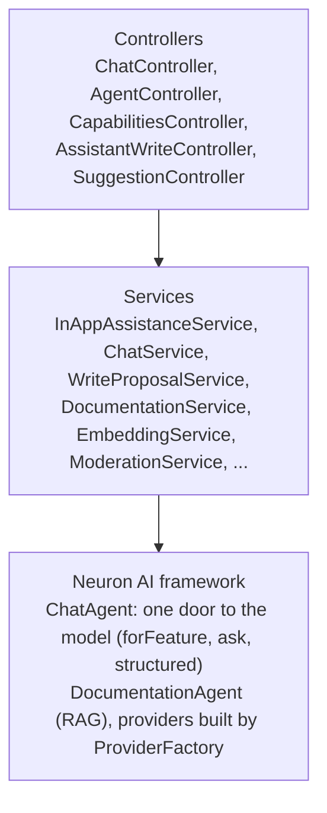
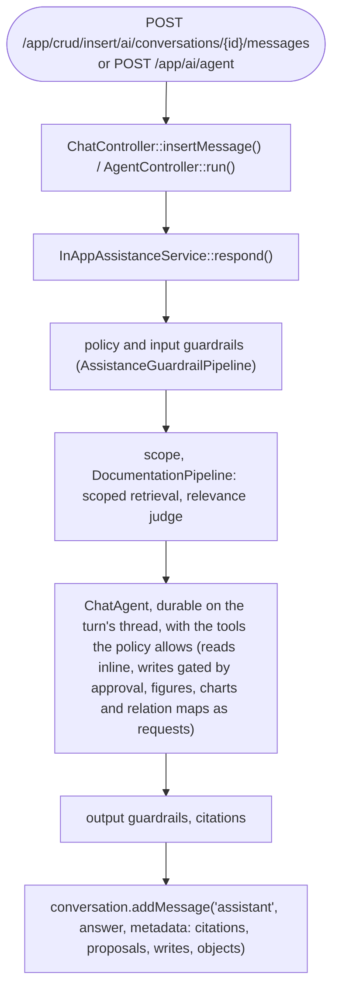
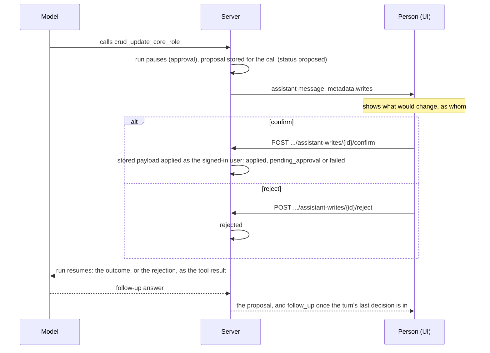
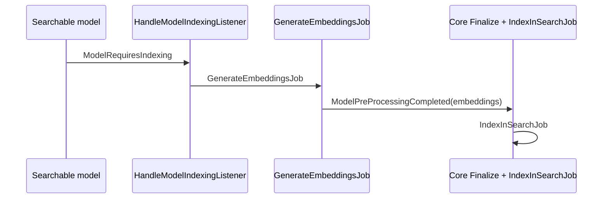
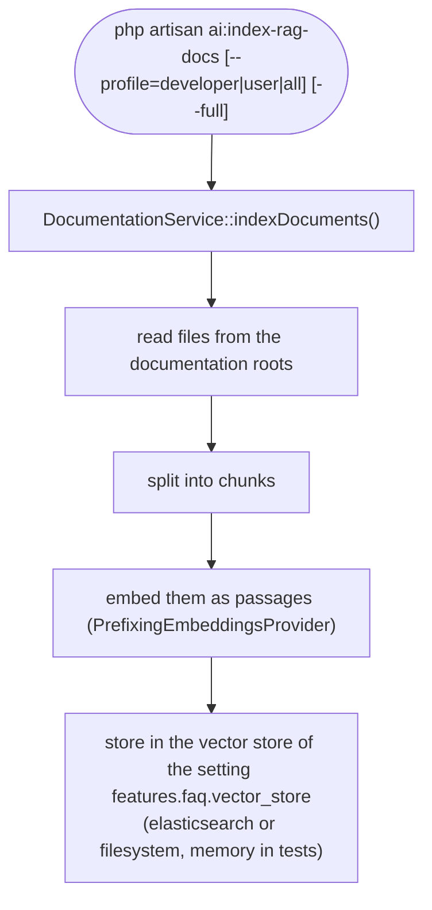
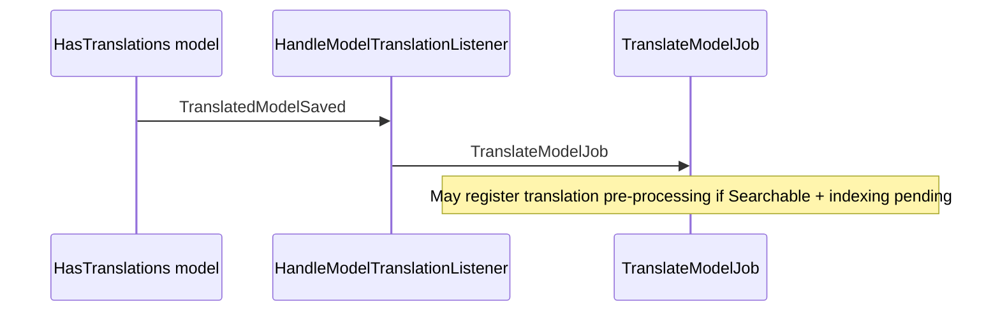
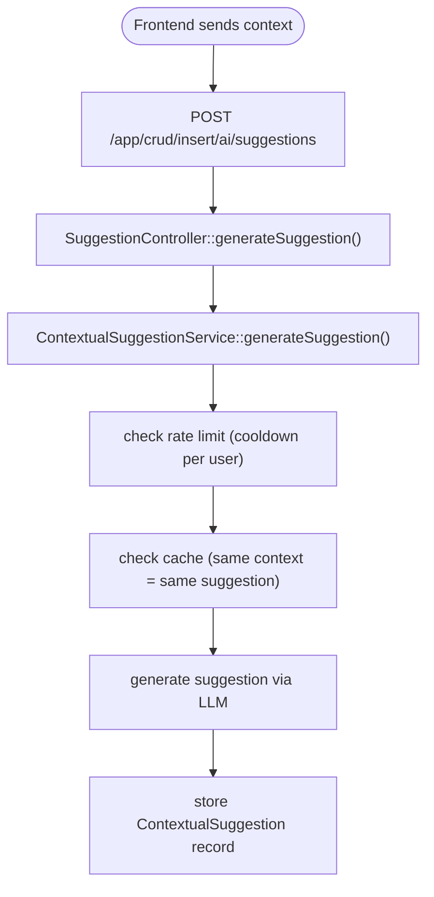

# AI Module - Architecture Documentation

How the parts of the module fit together. The message path of the in-app assistant (policy, guardrails,
scope, tools, the event stream) is described in `docs/rag/MODULE.md`, sections *Perimeters* and *Message
orchestration*; this file points there rather than repeating it.

## Table of Contents

- [Overview](#overview)
- [Core integration (indexing & moderation)](#core-integration-indexing--moderation)
- [Assistant messages](#assistant-messages)
- [Tool System (governed writes)](#tool-system-governed-writes)
- [Embedding & RAG System](#embedding--rag-system)
- [Translation System](#translation-system)
- [Memory & Summarization](#memory--summarization)
- [Contextual Suggestions](#contextual-suggestions)
- [API Endpoints](#api-endpoints)
- [Feature Status](#feature-status)

---

## Overview



Each AI feature takes its provider and model from its own setting (`features.*.model`); see
`docs/rag/AI_MODEL_SELECTION_DEVELOPER.md`.

---

## Core integration (indexing & moderation)

Cross-module pipelines are documented with **Mermaid** diagrams in dedicated guides (keep this file for in-module features: assistant, RAG, tools).

| Pipeline | Canonical doc |
|----------|----------------|
| Search indexing, embeddings, `IndexInSearchJob` | [Core: EVENT_ORCHESTRATION §1](../../Core/docs/EVENT_ORCHESTRATION.md#1-search-indexing-embeddings--translations) · [AI: SEARCH_AND_TRANSLATION](./SEARCH_AND_TRANSLATION.md) |
| Modification moderation, registry, votes | [Core: EVENT_ORCHESTRATION §2](../../Core/docs/EVENT_ORCHESTRATION.md#2-modification-moderation-approvals--optional-ai) · [AI: MODERATION](./MODERATION.md) · [CMS: COMMENT_MODERATION](../../CMS/docs/COMMENT_MODERATION.md) |

---

## Assistant messages

| Component | File | Purpose |
|-----------|------|---------|
| `ChatController` | `Http/Controllers/ChatController.php` | Conversations and the JSON message route |
| `AgentController` | `Http/Controllers/AgentController.php` | `POST /app/ai/agent`: the run as an event stream, the answer sent whole |
| `InAppAssistanceService` | `Services/Assistance/InAppAssistanceService.php` | Every message: policy, guardrails, scope, documentation and tools, one validated answer |
| `ChatService` | `Services/ChatService.php` | Conversation lifecycle and the protected agent |
| `DocumentationPipeline` | `Ai/Rag/Pipeline/DocumentationPipeline.php` | The documentation half of the turn on Neuron's RAG contracts: a retrieval strategy, then the post-processors |
| `WriteApprovalGate` | `Services/Assistance/Writes/WriteApprovalGate.php` | Where a run paused on a write meets the proposal the person decides on |
| `AgentRunStorage` | `Ai/Runs/AgentRunStorage.php` | Neuron's `EloquentPersistence` and `EloquentMessageStore` on the module's tables |
| `Conversation`, `Message`, `AssistantTurn` | `Models/` | Persistence |

Every message goes through `InAppAssistanceService::respond()`, which is policy-compiled, guardrailed,
scope-resolved and, by default, stateless across messages: no earlier turn is replayed to the model. With
conversation memory on (`features.chat.history.enabled`, off by default; `memory_enabled` on the conversation),
the authorized context carries the last turns of the same conversation as data (`ConversationHistory`,
`docs/rag/ASSISTANT_HISTORY_SECURITY_REVIEW.md`). Nothing is remembered across conversations. Each message is one
**turn** (`AssistantTurn`, `ai_assistant_turns`) whose id is the Neuron thread of a durable run: its records live
in `ai_agent_workflow_records` (`EloquentPersistence`) and its working conversation (the question, the tool calls and
their results, the answer) in `ai_agent_messages` (`EloquentMessageStore`). That is what lets a turn paused on a write
resume in a later request; the next message starts a new turn, with a new thread. Turns are pruned with their
records seven days after their last change, and purged with the conversation.

The instructions of the agent are the compiled policy and are marked for the provider's prompt cache
(`SystemMessage::cache()`); they stay the same from one turn to the next for the same person. The authorized
context of the turn (citations, authorized results, presentation preferences) is Neuron's turn context
(`Agent::setContext()`): it is sent after the question, on every request of the turn, and never stored.

When the tools of a turn exceed `ai.features.tools.search.threshold` (30), the tools that act on one entity wait
behind Neuron's `tool_search` (`ToolSearchOffer`, `ToolSearchMiddleware`): a local keyword search, no model call. A
tool the model finds is offered for the rest of the turn. With `ai.features.rag.retrieval_tool.enabled` the model
may also search the user documentation itself (`search_documentation`, Neuron's `RetrievalTool` over the same scoped
retrieval, each passage guarded like a tool result and cited); the retrieval before the answer still runs.

No token of the model is
streamed: `POST /app/ai/agent` streams lifecycle events and one validated message, and
`POST .../messages` answers the same message as JSON. The stream route `POST .../stream/...` answers 422
(`in_app_streaming_unavailable`).



---

## Tool System (governed writes)

The assistant never changes data by itself. A write tool (`crud_create_*`, `crud_update_*`, `crud_delete_*`, `crud_bulk_update_*`, `crud_bulk_delete_*`) waits for approval (Neuron's tool approval): when the model calls one, the run of the turn pauses before anything is written, and `WriteApprovalGate` runs the tool's handler, which validates the call and stores a **write proposal** (`ai_write_proposals`) linked to the turn and to the call. A call that produced no proposal (invalid arguments, the write budget) is approved at once: there is nothing to decide, and it answers the model with why, so the model can correct itself in the same turn. The person confirms or rejects the proposal through an authenticated action the model cannot perform, and only then is the stored payload applied, as that person, through `CrudService`. Whether the write is also sent for a vote is decided by Core approvals at the model (`HasApprovals`), not by the assistant.

Once every proposal the turn waits for is decided (confirmed, rejected or expired), the decision endpoint resumes the run (`InAppAssistanceService::continueAfterDecision()`): Neuron carries out the approved calls, which answer with what came of the proposal (the write is never applied twice), hands the rejections to the model as such, and the model writes a **follow-up** message, validated like any answer and returned under `follow_up`. The agent is rebuilt for the person deciding, with the data tools of the same question and application context; the page proposals and the widgets of the first answer are not offered again. A follow-up that cannot be written leaves the decision as it is.



Read tools (`crud_list_*`, `crud_detail_*`, ...) run inline, under the permissions and row-level ACL of the person. Which tools exist for a person is the intersection of three things: the operator's opt-in (`ai.features.tools.crud.entities`, plus `unmoderated_writes` for entities without approvals), the person's permissions, and the policy capabilities `crud_reads` and `governed_writes` of the in-app profile. `approve` and `disapprove` are never offered: a decision on a pending change is made by a person in the panel. A read result whose text reads like an instruction is withheld from the model (`ToolResultGuard`).

Details, states, routes and the metadata shape are in `docs/rag/MODULE.md` (*Writes through the assistant*) and `docs/TOOLS_USAGE_EXAMPLE.md`.

Figures and charts are computed by the application, not by the model. `show_widget` (capability `widget_objects`) validates an aggregate request on an entity opted into `summarize`, runs it once so the model can describe it, and stores the request with the title the model chose in `metadata.objects`; the client runs the request through the aggregate route with the person's session and renders it. The title is model text (plain text, at most 80 characters), so a number in it is not a computed figure. When the policy allows `graph_expand`, the same tool stores the relation map of one record as a graph request, expanded once through Core's graph gateway, and the model is told only how many nodes and edges of each type it holds; the client runs it through the graph expand route. The tool is built only when the page declared an object type the tool can show in the turn (`context.page.objects`): a figure or a chart when the acting person is offered `summarize` on at least one entity, a graph when the policy allows `graph_expand`. Details: `docs/rag/ASSISTANT_WIDGETS_DEVELOPER.md`.

---

## Embedding & RAG System

### Embedding generation flow

> **Full workflow (sequence + state diagrams):** [SEARCH_AND_TRANSLATION.md](./SEARCH_AND_TRANSLATION.md) · [Core EVENT_ORCHESTRATION](../../Core/docs/EVENT_ORCHESTRATION.md#1-search-indexing-embeddings--translations)



### RAG (Documentation Search) Flow



Questions are answered from it in two places: the in-app assistant retrieves the user corpus through
`DocumentationService::retrieveForInApp()` (see *Assistant messages*), and `php artisan ai:help` answers
from the developer corpus with `DocumentationAgent`, citing the documents it used. Details:
`docs/rag/MODULE.md`.

---

## Translation System

### Automatic translation flow

> **Full workflow:** [SEARCH_AND_TRANSLATION.md](./SEARCH_AND_TRANSLATION.md#2-automatic-translation)



---

## Memory & Summarization

`MemoryService` summarises a conversation and extracts its key facts (a Neuron structured output,
`ExtractedFacts`), and keeps the snapshots in `ConversationSummary`. It is kept for the persistent user
memory plan, which is not planned at present; the in-app assistant does not call it. Conversation memory is a
window of recent turns read from the conversation's messages (`ConversationHistory`, off by default, see
`docs/rag/ASSISTANT_HISTORY_SECURITY_REVIEW.md`), with no summary.

```php
// MemoryService::shouldSummarize()
if (!$conversation->memory_enabled) return false;
if (!config('ai.features.chat.summary.enabled')) return false;

$message_count = $conversation->messages()->count();
$threshold = config('ai.features.chat.summary_threshold', 20);

// Check messages since last summary
$last_summary = $conversation->summaries()->first();
if ($last_summary) {
    return ($message_count - $last_summary->message_count) >= $threshold;
}

return $message_count >= $threshold;
```

`features.chat.summary.enabled` is a setting in Filament (seeded off); `summary_threshold` is a fixed value
in `config.php`. `createSummarySnapshot()` runs `summarizeConversation()` and `extractFacts()`, stores the
summary on the conversation and writes a `ConversationSummary` row.

---

## Contextual Suggestions

### Purpose

Proactive AI suggestions based on user's current UI context (page, action, data).

### Flow



---

## API Endpoints

All routes are under `/app`.

### Assistant Routes

| Method | Path | Controller Method | Purpose |
|--------|------|-------------------|---------|
| GET | `/app/ai/capabilities` | `CapabilitiesController::show` | What the assistant may do for the signed-in person |
| POST | `/app/ai/agent` | `AgentController::run` | The run as an event stream, the answer sent whole |
| GET | `/app/crud/select/ai/conversations` | `listConversations` | List the user's conversations |
| POST | `/app/crud/insert/ai/conversations` | `insertConversation` | Create a conversation |
| GET | `/app/crud/detail/ai/conversations/{conversation}` | `detailConversation` | Conversation details |
| DELETE | `/app/crud/delete/ai/conversations/{conversation}` | `deleteConversation` | Delete a conversation |
| GET | `/app/crud/select/ai/conversations/{conversation}/messages` | `listMessages` | List messages |
| POST | `/app/crud/insert/ai/conversations/{conversation}/messages` | `insertMessage` | Send a message, JSON answer |
| POST | `/app/crud/stream/ai/conversations/{conversation}/messages` | `streamMessage` | Answers 422: no token streaming |

### Assistant Write Routes (proposals)

| Method | Path | Controller Method | Purpose |
|--------|------|-------------------|---------|
| GET | `/app/crud/detail/ai/assistant-writes/{proposal}` | `show` | A proposal: what would change, as whom, its status |
| POST | `/app/crud/update/ai/assistant-writes/{proposal}/confirm` | `confirm` | The person applies it (once; a second call answers the same outcome) |
| POST | `/app/crud/update/ai/assistant-writes/{proposal}/reject` | `reject` | The person declines it |

### Suggestion Routes

| Method | Path | Controller Method | Purpose |
|--------|------|-------------------|---------|
| GET | `/app/crud/select/ai/suggestions` | `listSuggestions` | List pending suggestions |
| POST | `/app/crud/insert/ai/suggestions` | `generateSuggestion` | Generate a new suggestion |
| POST | `/app/crud/update/ai/suggestions/{suggestion}/dismiss` | `dismissSuggestion` | Dismiss a suggestion |

### Authorization

All endpoints require authentication. Conversation access is restricted to the owner, and the message
routes also require the in-app assistance profile (`AssistantAccessContextFactory::forInApp()`).

---

## Feature Status

| Feature | Status | Notes |
|---------|--------|-------|
| In-app assistant | Active | JSON answer or event stream; policy, guardrails and scope on every message |
| RAG/FAQ | Active | User corpus for the assistant, developer corpus for `ai:help` |
| Governed writes | Active | Propose, then the person confirms (`ai_write_proposals`) |
| Widget objects | Active (backend) | `show_widget` emits figures and charts as aggregate requests, and relation maps as graph requests, in `metadata.objects`; a client renders them |
| Contextual Suggestions | Active | Setting `features.contextual_suggestions.enabled` (seeded off) |
| Memory/Summarization | Kept, not called | Setting `features.chat.summary.enabled`; for the persistent user memory plan, not planned at present |
| Conversation memory | Off by default | Settings `features.chat.history.{enabled,turns}`; `memory_enabled` per conversation |
