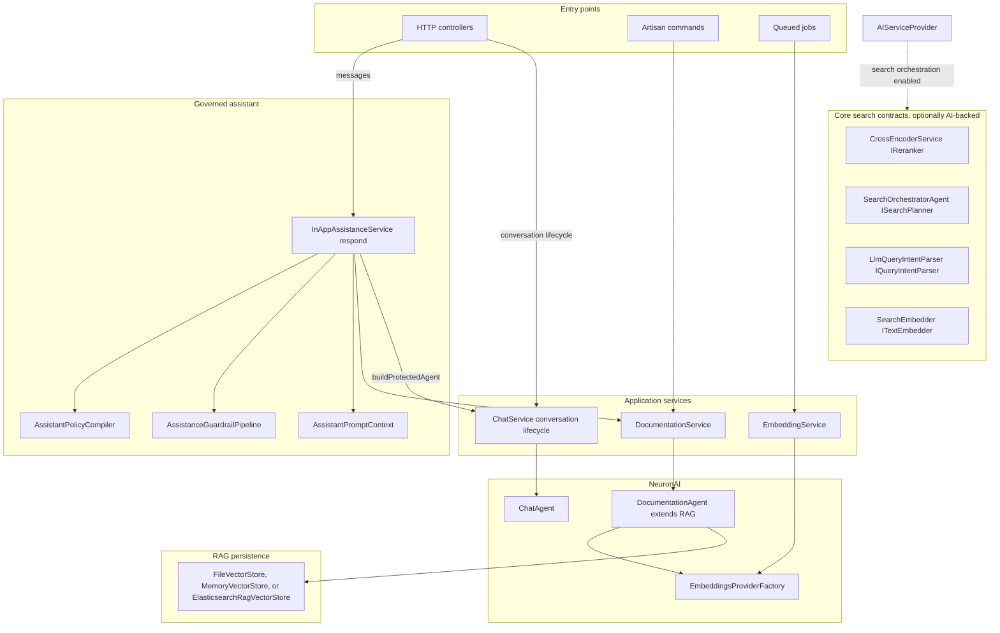
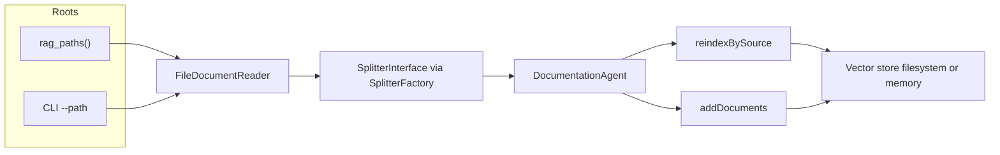
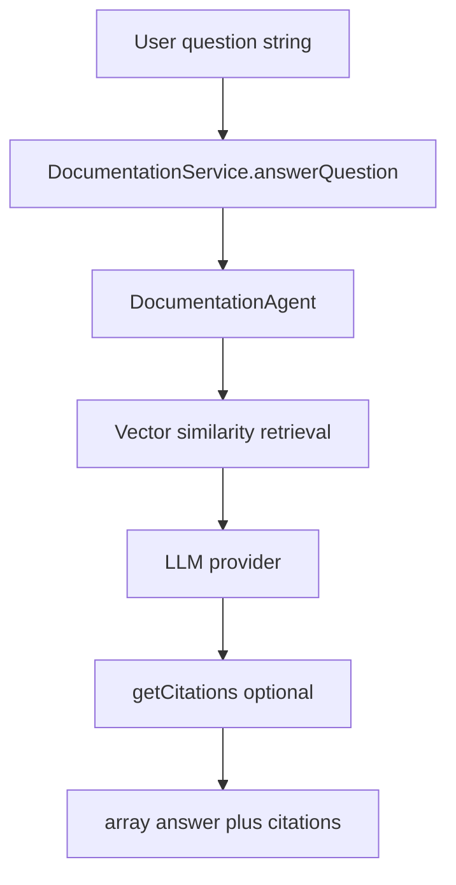
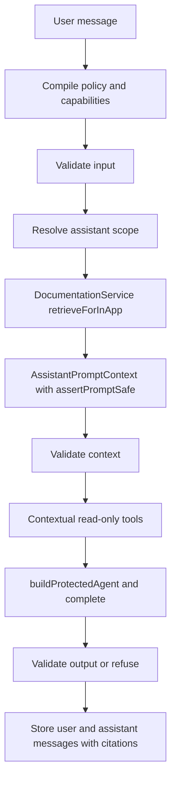
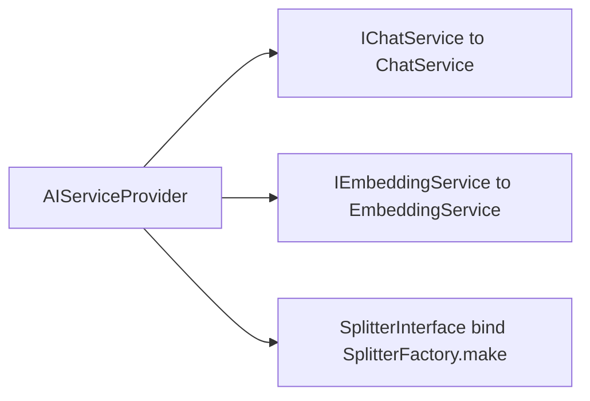

# AI module — RAG, tools, and assistant orchestration

## Purpose

`AI` provides documentation intelligence for Laraplate: ingest docs, index them for semantic retrieval, answer user questions with RAG, and orchestrate tool-assisted conversations with approval controls.

### Perimeters

The boundaries of this module are **contracts, not folders**. `AI` is not one system: it is a set of subsystems that touch each other rarely, and reading it as a single pipeline is what makes it feel larger than it is. The reliable way to tell them apart is by entry point, because an entry point cannot be wishful.

| Perimeter | Entry point | Boundary | Status |
|---|---|---|---|
| **In-app assistant** | `POST /crud/insert/ai/conversations/{conversation}/messages` → `InAppAssistanceService::respond()` | policy, guardrails, scope resolution | live; the only path a user message travels |
| **Search** | `CrudService` → `AdvancedSearchService` → `EnsembleSearchService` | Core contract `ISearchStrategyResolver` | live |
| **Documentation RAG** | `DocumentationService`, from `respond()` and from `ai:help` | corpora plus the configured vector store | live |
| **Application content** | CMS and SAO retrieval providers, consumed by `respond()` | citations and authorized evidence | live |
| **Tools and governed writes** | tools offered by `CrudToolProvider` to `respond()`, and `show_widget`; `AssistantWriteController` for the person's confirmation | policy capabilities `crud_reads` / `governed_writes` / `widget_objects`, Core approvals at the model | live; writes are proposals the person confirms, figures, charts and relation maps are requests the client runs |
| **Contextual suggestions** | `SuggestionController` | per-context generation | live |
| **Moderation and translation** | queued jobs | asynchronous, no HTTP surface | live |
| **Conversation memory** | none | none | dormant |

**Search is not a chat feature, and it does not live here.** The perimeter belongs to `Modules/Core/Search`. A search asks for a mode per request, `fast`, `balanced` or `deep`, and Core resolves the components for it through one contract, `ISearchStrategyResolver`. Core binds a resolver that always returns its own cheap components (`FallbackSearchPlanner`, `HeuristicReranker`, `SimpleQueryIntentParser`). When the AI module is installed it replaces that single binding with `AiSearchStrategyResolver` (`AIServiceProvider`): `balanced` adds the query embedding (`SearchEmbedder`), and `deep` adds `SearchOrchestratorAgent`, `LlmQueryIntentParser`, `CrossEncoderService` and up to two retries. It does not rebind `ISearchPlanner`, `IReranker` or `IQueryIntentParser`, so a `fast` search never builds an AI class. Anything that prevents the requested mode is served by a cheaper one and reported in `meta.search.degraded_reason`. Query planning, embedding and reranking are therefore an **optional upgrade to Core search**, which keeps working without AI. They meet the assistant only when it runs a search, through the same contract the CRUD layer uses.

**The compass for reading any of this:** when two subsystems speak through a contract in Core, they are separate by construction and can be understood one at a time. When they speak by importing each other directly, they are coupled and have to be thought about together. In this module almost everything goes through contracts; the only genuine direct dependencies are `respond()` towards documentation retrieval, tools and policy.

#### Two perimeters worth a caveat

- **Writes are proposals.** The in-app assistant can propose a create, update, delete or bulk change; it never applies one. See *Writes through the assistant* below. The earlier `ActionRequest` path (`ActionRequestService`, `RiskClassifier`, `ExecuteActionRequestJob`, the global tool registry) had no producer and duplicated Core approvals; it was retired on 2026-10-07 together with its table `ai_action_requests`.
- **Conversation memory is dormant, not broken.** `MemoryService` summarizes conversations and extracts facts, but its hook lived in the superseded chat, so it never runs. `respond()` is also stateless per message: it builds a fresh agent and sends only the current input, with no history and no summary.

#### Writes through the assistant

The assistant acts as the signed-in person, with exactly their permissions and row-level ACL, evaluated by `CrudService` at the moment of each call.

- **What exists.** `CrudToolProvider::offeredOperations()` is the single answer to "what may the assistant do for this person": the entities and operations the operator opted into (`ai.features.tools.crud.entities`), that the person is permitted to perform. An entity whose model has no approvals gets write tools only if it is listed under `ai.features.tools.crud.unmoderated_writes`. `approve` and `disapprove` are never offered. The policy (`AssistantPolicyCatalog`) admits the tools by wildcard name (`crud_*`) through two capabilities, `crud_reads` and `governed_writes`, granted to the in-app profile only; `DeveloperHelp` cannot receive them.
- **A write is a proposal.** The write tool stores a row in `ai_write_proposals` (operation, exact payload, a bounded summary of what would change, whether Core would send it for a vote, the acting user, an expiry) and returns "nothing has been changed". A bulk proposal stores the ids that matched, so the person confirms what they were shown; the cap is 200 records and a turn may create five proposals.
- **The person confirms outside the model.** `POST /app/crud/update/ai/assistant-writes/{proposal}/confirm` (and `/reject`, `GET .../{proposal}`) is an authenticated action of the person the proposal belongs to, in their own conversation. It applies the stored payload through `CrudService`; permission and ACL are decided again, and the operator's opt-in is checked again. The outcome is `applied`, `pending_approval` (Core captured it for a vote; the modification ids are recorded), `failed`, or the proposal was `rejected` or `expired`. Confirming twice writes once.
- **What the client sees.** The assistant message carries `metadata.writes`: `{id, tool, module, entity, operation, status, acting_user_id, acting_user_name, summary, requires_approval, outcome, expires_at, resolved_at}` per proposal, and its text always says that nothing changes until the person confirms, in the person's language; a sentence claiming a change was made is replaced. `GET /app/ai/capabilities` returns `features.writes` and `actions`: each entity and operation the assistant may perform for the signed-in person, with `kind` (`read` or `write`) and `requires_approval`.
- **Who is acting.** The system prompt carries a server-built block naming the acting user and listing exactly the entity/operation pairs offered; the name is quoted data. Every proposal, confirmation and rejection is logged (`Assistant write`) with actor, conversation, tool, entity, operation, a hash of the payload and the outcome, never the values.
- **Confinement.** Input is classified before anything runs (override, role reassignment, exfiltration, claimed authority, chat-markup impersonation, hidden characters; English and Italian). What an entity read tool returns is withheld from the model when its text reads like an instruction. A write cannot be applied by the model in any way: there is no parameter and no tool for it.
- **Not covered.** Core records no origin on a modification, so the log is where assistant writes are told apart. Mass query writes that bypass model events are outside Core approvals and outside this.

#### Figures, charts and relation maps through the assistant

The same opt-in that offers `summarize` on an entity (`ai.features.tools.crud.entities`) lets the assistant put a figure (`kpi`) or a chart in its answer, through the tool `show_widget` of the capability `widget_objects`. When the policy allows `graph_expand` (capability `read_only_graph`), the same tool can also put the relation map (`graph`) of one record in the answer, with no `summarize` opt-in.

- **Summaries run on the aggregate engine.** `summarize` delegates to Core's `CrudService::aggregate()`: it covers every row the person may read, groups by one column or by a time bucket over a period, returns the first `max_groups` groups and the rest as `other`, and reports mixed currencies as a warning instead of adding them.
- **An object is a request, not figures.** `show_widget` validates the model's aggregate request as the route does, runs it once so the model can describe it, and stores it in `metadata.objects` as `{id, type, title, ref: {request, variant?, format?}}`. The client runs the request through the aggregate route with the person's session and renders it: the figures, the totals, the series and the comparison come from the application, and only the title (plain text, at most 80 characters) is the model's, so a number in a title is not a computed figure.
- **A map is a request too.** For a `graph`, `show_widget` validates `{resource, id, relations, depth?, node_detail?}` within the bounds of `graph_expand` (1 to 10 relation paths, depth 1 or 2), expands it once through Core's `GraphToolGatewayInterface` under the person's permission and ACL, at most 25 nodes and 10 records per relation, and stores `{request: {kind: graph, ..., limit: 25, relation_limit: 10}}` with those limits, so the client draws the map the model was told about. The model is told only how many nodes and edges of each type the map holds, never a label or a value. The client runs the request through `GET /app/crud/graph/expand/{module}/{entity}/{id}`.
- **Offered only when asked for.** The tool exists for a turn only when the scope reaches data, the policy allows it, and the page declared in `context.page.objects` (a hint that narrows and grants nothing) a type the tool can show in the turn: `kpi` or `chart` when an entity is opted into `summarize` and the acting person is offered `summarize` on at least one of them, `graph` when the policy allows `graph_expand`. A message holds at most `core.aggregate.max_objects_per_message` objects (6 by default). The stream sends one `ToolCall` event per object, which never interrupts the run. `GET /app/ai/capabilities` returns `features.objects` and `limits.aggregate`.
- Details, refusals and shapes: `ASSISTANT_WIDGETS_DEVELOPER.md`.

#### What was removed, and why it still appears in history

`ChatService` once carried the unprotected message path: `sendMessage()`, `sendMessageStream()`, `sendMessageWithTools()` and their `buildAgent()` helper, including a RAG shortcut driven by question detection and a `use_rag` context flag. Those were superseded when the HTTP boundary moved to `InAppAssistanceService`, which applies policy, guardrails and scope, and which is non-streaming by design because output cannot be validated once it has been streamed. They were removed after a period of being unreachable. `ChatService` now holds only `createConversation()` and `buildProtectedAgent()`; older commits, tests and documentation that describe it as the chat orchestrator are describing a design that no longer exists.



## Core capabilities

### RAG ingestion and indexing lifecycle

- Reads documentation files from roots resolved by `rag_paths()` (or explicit CLI `--path`).
- Splits documents into chunks and stores vectors in configured vector store backend.
- Supports incremental reindex-by-source, a diff (`--diff`) and a full rebuild (`--full`); see *Indexing modes* below.
- Keeps source prefixes to improve citation traceability by module/path.

For multi-instance deployments (shared corpus across replicas), see [`DEPLOYMENT.md`](DEPLOYMENT.md) (`filesystem` on a shared volume, or `elasticsearch` as the recommended production driver).

#### RAG indexing pipeline

`indexDocuments()` resolves one or more roots: either the CLI `--path` with a synthetic prefix, or every directory returned by `rag_paths()` with prefixes such as `faq-module-{Name}` or `faq-app-rag`. `FileDocumentReader` walks each root and builds one `Document` per file (`sourceName` includes the prefix). `SplitterInterface` (default `MarkdownAwareSplitter` from `SplitterFactory`) splits each document into chunks. If the configured vector store already holds data and `--full` was not passed, `DocumentationAgent::reindexBySource()` updates chunks per logical source; otherwise `addDocuments()` appends. Chunks are embedded as passages (the `passage_prefix` of the active profile is added when the chunk is embedded, and is not part of the stored text). A documentation index built before this was done holds chunks embedded without the prefix on a model that expects it (E5): rebuild the documentation indexes after upgrading, with `php artisan ai:index-rag-docs --full` for each profile (or an embedding model switch). Chunks reach the agent in batches of about 100 that never split a source: `reindexBySource()` deletes every source it receives before adding it, so a source spread over two batches would lose the first batch's chunks. A source with more than 100 chunks travels as one batch. A full rebuild deletes the filesystem store file or resets the in-memory singleton when the driver is `memory`.



#### Chunk metadata, the two corpora and a wrong audience

`FileDocumentReader` turns the YAML front matter of a file into its metadata as declared, removes it from the indexed text, and adds only an empty `heading_breadcrumb`. Invalid YAML yields no metadata. The splitters copy the document metadata to every chunk, and `MarkdownAwareSplitter` replaces `heading_breadcrumb` with the headings of the chunk.

- **Developer corpus.** Every chunk carries `audience`, `module`, `locale`, `canonical_source`, `heading_breadcrumb` and `source_type`. What the front matter declares is kept; what it leaves absent or blank gets a neutral default (`DocumentationMetadata::applyDeveloperDefaults()`): audience `shared`, module `app`, locale `und`, the source name (with its `faq-module-{Name}` prefix) as canonical source, an empty breadcrumb, and source type `file`. A legacy file without front matter is therefore indexed with those values.
- **User corpus.** No default is applied. `DocumentAudiencePolicy` admits a document on its declared metadata alone (audience `user` or `shared`, module, locale, canonical source, safe source label, version, `policy_classification: user_safe` with the configured version, required permissions and tenant scope), so a file without front matter never reaches it, and the developer defaults cannot satisfy the policy: they set no safe source label, version, classification or tenant scope.
- **Unknown audience.** The accepted values are `user`, `developer` and `shared` (`DocumentationMetadata::AUDIENCES`, exact and case-sensitive; an absent or empty `audience` is not an error). Any other value throws `UnknownDocumentAudienceException` from the reader, naming the file and the value, and the indexing stops: `ai:index-rag-docs` prints `Indexing failed: ...` and exits non-zero, for every profile. All sources are read before anything is written, so the store keeps what it held, even with `--full`. An embedding model switch reads the sources (`DocumentationService::validateSources()`) before recreating the documentation indexes, so it stops with the indexes whole. Fix the front matter and index again.

- **Position and key.** The indexing numbers the chunks of each document (`section`, from 0) and gives each the opaque key of its document (`document_key`, `d_` and 32 hex characters, a hash of `module`, `locale` and `canonical_source`; none when the document does not declare all three). Both are written by `DocumentationService` after the splitter, so they do not depend on the configured splitter. The user index maps them, the read route filters on the key (`docs/SEARCH_AND_TRANSLATION.md`, *Documentation read route*) and the safe projection of retrieval keeps both and still drops `canonical_source`. Chunks indexed before this change have neither and are read after `ai:index-rag-docs --full`.
- **Citations.** A documentation citation of an answer carries `kind: documentation`, `label`, `excerpt`, `score` and, for a chunk with a key, `reference` (the key) and `section`; an application content citation carries `kind: content` and its canonical `/app/...` reference. `AssistanceContextPolicy` admits `kind` (`documentation` or `content`) and `section`, takes the document key as the reference of a `documentation` citation and an application path as that of any other. The assistant evaluation compares citation labels only, so none of this changes it.

The Elasticsearch mapping types `source_type` as a `keyword`. An index created before that maps the field dynamically on the first write. The mapping changes on the next `ai:create-rag-index --force` or model switch.

### Question answering

- Uses retrieval + LLM response generation through `DocumentationService::answerQuestion`.
- Returns normalized output with answer + structured citations.
- Can append formatted citation section in final answer.

#### Retrieval strategy decision

The required baseline is curated **vector documentation RAG**. Elasticsearch kNN is the recommended production retrieval path; filesystem remains a simple single-instance option and memory is test-only. Laraplate does not currently depend on Graphify, GraphRAG, or a graph database.

Retrieval evolves only through measured stages: evaluation dataset, metadata/scoping, optional hybrid lexical + vector retrieval, optional reranking, and only then an evidence-gated graph spike for residual multi-hop failures. A future graph retriever must remain optional, disabled by default, preserve canonical document citations, and fall back to the non-graph path. The UI Graph Explorer is a separate product capability and is not the RAG knowledge graph.

**Where the roadmap stands (2026-10-08).** Retrieval is vector-only: `InAppDocumentationRetrieval` (the user index, with the audience policy) and `DeveloperDocumentationRetrieval` (the developer index) embed the question with the active profile's `query:` prefix, search Elasticsearch kNN, and drop hits below `AI_FAQ_MIN_SIMILARITY` (off by default; on e5-small the useful band is about 0.01 wide, so it is tuned per corpus). There is no strategy setting and no retrieval factory: they were cancelled because there is only one strategy. Measured on the production model with symmetric prefixes, the developer datasets (`docs/rag/evaluations/2026-09-17-developer-core-vector-baseline.json`, `2026-09-18-developer-retrieval-report.json`) give hit@5 1.00 and 0.90, MRR 0.80. Hybrid lexical retrieval and documentation reranking are deferred: the measurement does not justify them, and they reopen if a larger corpus shows real misses. No graph spike is authorized: the gate needs at least 10 unsolved multi-hop cases and the largest dataset has 20 cases. Evaluate with `test:ai:evaluate-documentation --index=user|developer`.

The authoritative design and implementation roadmap are:

- `docs/superpowers/specs/2026-07-16-rag-retrieval-strategy-design.md`
- `docs/superpowers/plans/2026-07-16-rag-retrieval-strategy.md`

#### RAG question answering flow

`answerQuestion()` instantiates `DocumentationAgent::make()` with `topK` from `ai.features.faq.max_documents`. The agent runs Neuron RAG retrieval over the vector store, then the LLM produces the assistant message. If the message exposes `getCitations()`, each citation is mapped to `source`, `excerpt`, and `score`. When `ai.features.faq.format_citations` is true, a markdown **Sources** block is appended to the answer string returned to callers.



### Relevance judge

An optional stage between the retrieval of the user documentation and the answer of the in-app assistant. It is off by default.

- **Where it runs.** `InAppAssistanceService::respond()` calls `RelevanceJudgeStage::run()` right after the documentation retrieval and before the prompt context is built, only when the assistant reads documentation (`AssistantCapabilities::help()`, that is `features.faq.enabled`). The retrieval it repeats is the same closure, so later rounds keep the access context and the scope. It is not inside `InAppDocumentationRetrieval::retrieve()`, because the command palette search (`DocumentationSearch`) shares that method and must not make a model call. The developer path (`ai:help`, `DocumentationAgent`, `DocumentationService::answerQuestion()`) and the search of application content are not judged.
- **Settings.** `features.rag.judge.enabled` (seeded `false`), `features.rag.judge.max_rounds` (3), `features.rag.judge.min_sources` (3), `features.rag.judge.excerpt_chars` (600) and the model dropdown `features.rag.judge.model` (`AiModelFeature::RelevanceJudge`; choices are `provider:model` values written by the seeder and refreshed by `ai:models:refresh`, like the other feature models). `ai.features.rag.judge.timeout` (10 seconds, `0` = no limit) is config only. The description of the enable setting says that a model smaller than a mid-size instruction-tuned one usually makes judging worse.
- **What the judge reads and returns.** For each candidate: a number, the title (source name plus heading breadcrumb), the date when the metadata has one (the first of `date`, `updated_at`, `published_at`, `valid_from`) and an excerpt cut at `excerpt_chars`. It answers through structured output (`JudgeAnswer`) with the numbers of the relevant candidates and an optional `next_query`. The call uses temperature 0 and no retry. Round 1 asks for a more precise next query, later rounds for a broader one with synonyms. Numbers outside the candidate list or repeated are ignored.
- **Rounds.** Round 1 judges the first retrieval. Each next round retrieves again with the proposed query and judges only documents not judged before (a document is identified by source type, source name and content, since the safe projection assigns new ids on every retrieval). The stage stops when the kept documents reach `min_sources`, when the judge proposes no next query, when a round brings nothing new, or after `max_rounds`. The answer is built from the kept documents.
- **Fallback.** A failure or timeout of any judge call, a verdict that is not usable, or no document kept at the end returns the unjudged candidates of round 1 (`JudgeRun::$fallback` true); documents kept in earlier rounds are dropped in that case. A failed retrieval of a next query only ends the rounds. The question is always answered.
- **Off.** With the setting off no call is made, the candidates are returned as given and the query log document has no `judge_*` field.
- **Logging.** The log gains the `judge_*` fields (see *Documentation query analytics*). Recreate the query-log index with `php artisan ai:create-rag-query-index --force` before enabling the judge: the mapping is strict, so the document of a judged question is refused by an older index and that question is not logged (`rag_query_analytics_write_failed` in the application log).
- **Evaluation.** `test:ai:evaluate-documentation --index=user` sends the user index through the stage, so the setting changes what it measures; the developer index is never judged. Compare before enabling: run the command with the setting off (`--output=<off.json>`), turn `features.rag.judge.enabled` on with the candidate model in `features.rag.judge.model`, run again (`--output=<on.json>`) and compare `source_hit_at_k`, `mean_reciprocal_rank`, `citation_precision`, `supported_answer_rate`, `refusal_accuracy` and `latency_ms`. Enable it only if the numbers improve.

Classes: `Modules/AI/app/Ai/Rag/Judge/` (`RelevanceJudgeStage`, `RelevanceJudge`, `JudgeAnswer`, `JudgeVerdict`, `JudgeRound`, `JudgeRun`).

### Documentation query analytics

An optional, write-only log of the questions the in-app assistant answered from the user documentation, so corpus gaps, language mix, abstention rate and retrieval latency can be seen. It is off by default (setting `features.faq.query_logging.enabled`), and nothing in the application reads it: it never feeds retrieval, ranking or tuning. The privacy decisions are in `query-analytics-privacy-review.md`.

- **Where it is written.** `InAppAssistanceService::respond()` times the documentation retrieval and, once the answer is stored, hands it to `RagQueryRecorder`. The recorder checks the switch, skips guests and impersonated sessions (impersonation is known only in the request), builds a `RagQueryLog` and queues `LogRagQueryJob` with the finished document. `RagQueryAnalyticsWriter` indexes it. A refused turn is not logged, and nothing on this path can fail or delay the answer: a dispatch or write failure is logged with the exception class only.
- **What a document holds.** `id`, `logged_at`, `user_ref`, `tenant` (tenant id or `global`), `profile`, `locale`, `query`, `retrieved_count` (documentation documents after the similarity floor), `citation_count` (in this flow every retrieved document is cited, so it equals `retrieved_count`), `answered` (false when retrieval found nothing), `latency_ms` (retrieval only) and `index` (the user documentation index). Never the answer, document bodies or the user id. The index mapping (`RagQueryLogIndex`) is `dynamic: strict`, so a field outside the lists here is refused.
- **Judge fields.** Only when the relevance judge ran, the document gains `judge_rounds` (int), `judge_candidates` (int), `judge_kept` (int), `judge_fallback` (bool: the unjudged candidates were used), `judge_ms` (float, time of the judge calls), `judge_trace` (keyword, one `round=N candidates=N kept=1,3 ms=N` entry per round, `kept=-` when none) and `judge_queries` (text, the query of each round, one per line: round 1 is the question, later rounds are reformulations written by the model). `judge_queries` follows `query_text_mode`: it is stored only with `raw`, never with `off`.
- **Token fields.** `tokens_in_{role}` and `tokens_out_{role}` (integers, no text) for `answer` and `judge`, only for roles whose provider reported usage; see *Tokens per role and the data egress indicator*.
- **The question.** Stored as typed when `features.faq.query_logging.query_text_mode` is `raw` (the default), not at all when it is `off`.
- **The user.** `user_ref` is an HMAC-SHA256 of the user id under `APP_KEY` (`RagQueryUserReference`).
- **Retention and erasure.** `ai:prune-rag-queries` runs daily and deletes documents older than `features.faq.query_logging.retention_days` (30). `ai:erase-rag-queries {user}` deletes a user's documents, matching the HMAC under `APP_KEY` and every key in `APP_PREVIOUS_KEYS`, so a key rotation does not hide older documents. No user-erasure flow calls it yet. Both act with the log switched off, and do nothing when the index does not exist.
- **The index.** `ai:create-rag-query-index` creates it (`AI_FAQ_QUERY_LOG_INDEX`, default `{app}_rag_queries`); `--force` recreates it and loses the logged questions. Recreate it to take a new mapping: before enabling the judge (its `judge_*` fields are refused by an older index) and to record tokens per role.

### Tokens per role and the data egress indicator

- **Roles.** `AiRole` names `answer` (the model that writes the answer, feature `Chat`), `judge` (`RelevanceJudge`), `intent` (`SearchOrchestration`, the model that reads the intent of a search) and `embedding` (the active embedding profile).
- **Tokens.** `TokenUsage::fromAgent()` reads the usage that the provider put on the messages of an agent's history (summed over every call of a tool-calling answer). The answer and the judge are recorded in the query log as `tokens_in_{role}` and `tokens_out_{role}`: integers, no text, present only for a role whose provider reported usage (a provider that reports none leaves the fields out). `intent` and `embedding` have mapped fields too, but nothing writes them today: the intent parser is not on the documentation answer path and the embedding providers return vectors only. The mapping declares the eight fields.
- **Older indexes.** An index created before the token fields refuses them under its strict mapping. `RagQueryAnalyticsWriter` then writes the document again without the `tokens_*` fields and logs the notice `rag_query_analytics_tokens_not_mapped` with the index name. Recreate the index (`ai:create-rag-query-index --force`) to record tokens.
- **Egress indicator.** `RoleEgress::leavesInstallation(string $role): ?bool` says whether the text sent to a role's model leaves the installation: `true` for an external service (a provider configured by a key only, for example a hosted chat or embeddings API), `false` for a server the installation declares by URL (a server of `ai.servers`, the Ollama URL, an OpenAI-compatible base URL), `null` when it cannot be told (unknown or unconfigured provider). **It reflects the configuration, not the network**: a declared URL that points at a hosted service reads as staying.
- **Where it is shown.** In the confirmation of a change of the model of any AI feature in Settings, as a modal titled "Text leaves the installation" shown only when the new model's provider is external (a model that stays or is unknown saves without a modal); in the confirmation of the embedding model change (`EmbeddingModelSettingConfirmation`), whose last line says whether the target profile's text leaves or stays; and in `php artisan ai:servers:check`, which first prints a table of role, model and whether the text leaves, with no URL and no key, and then probes the servers. The settings form itself has no permanent indicator next to a field.

### Message orchestration

Every message sent over HTTP goes through `InAppAssistanceService::respond()`. It compiles the policy for the profile and the enabled capabilities (`application_content`, `in_app_rag` when the documentation is on, `read_only_graph`, `ui_proposals`, `crud_reads`, `governed_writes`, `widget_objects`), validates the input, resolves the assistant scope, retrieves documentation for that scope, builds an `AssistantPromptContext` from the authorized evidence, validates that context, and only then completes the answer through `ChatService::buildProtectedAgent()`, which wraps the evidence in an explicitly untrusted block. Output is validated before it is stored, which is also why no token of the model is ever streamed: an answer that has already been streamed cannot be refused. `POST /app/ai/agent` streams the run as lifecycle events and one complete validated message, as a wrapper of this same method (see `ASSISTANT_PROPOSALS_DEVELOPER.md`).

`ChatService` no longer orchestrates messages. Its remaining responsibilities are creating conversations and building the protected agent on behalf of the assistant.

Two properties of this path are easy to assume wrongly:

- **There is no question detection and no `use_rag` flag.** Whether documentation is retrieved is decided by the compiled policy and the resolved scope, not by heuristics on the message text.
- **The path is stateless per message.** A fresh agent receives the current input only, with no prior turns and no conversation summary, so the assistant does not recall earlier messages in the same conversation.

#### Why this path does not stream, and what to do about it

Validation on the way in does not constrain what the model composes on the way out, so
`AssistanceOutputPolicy` checks the generated text for restricted topics, PHP and SQL shapes,
env-var assignments, API keys, bearer tokens and JWTs, plus a length bound. What blocks
token-by-token streaming is not validation as such: it is three decisions that apply to the
**whole** answer. Insufficient evidence replaces the entire response, and is only knowable
once the model has finished deciding which tools to call; the length bound is measured on the
total; and a violation does not censor a fragment, it turns the whole answer into a refusal.

Streaming exists for perceived latency, and nearly all of it can be recovered without giving
any of that up: generate fully, validate, then deliver the validated text to the client
progressively. The reader sees an answer appear, no unchecked byte ever reaches the wire, and
a refusal stays a clean refusal instead of a retraction after a secret has already been shown.

Where it is worth doing: a chat surface, where the wait is the whole experience. Where it is
not: an API response consumed by code, which gains nothing from arriving in pieces, unless
that API backs a public-facing chat.



### Tool failures

A tool the model calls can fail: a missing required argument, a handler that throws, a tool called too often
in one turn. `ChatAgent` gives Neuron's `toolErrorHandler()` a handler that returns a fixed message as the
tool's result (never the exception text, which can name a parameter or a record) and logs the tool name
and the exception class; the model then tries again or answers without the tool, and the turn is not
refused. An `AssistancePolicyViolationException` is a policy decision, not a tool failure: it still ends
the turn. A tool may declare `ToolDefinition::$maxRuns`, how many times the model may call it in a turn
(`ToolRegistry` sets it with `Tool::setMaxRuns()`); `graph_*` and `crud_*` declare 3, `show_widget` declares
`max_objects_per_message` + 2 (8 by default), Neuron's default is 10.

### Structured output of the model

Where the module needs the model's answer as data, it asks through Neuron's structured output
(`Agent::structured($message, $class, $maxRetries)`) and never parses JSON itself: the class under
`Modules/AI/app/Data` carries the schema (`#[SchemaProperty]`) and the validation rules; Neuron sends the
schema, extracts the JSON (a Markdown fence is fine), deserializes and validates it, and when any step
fails asks the model again with the list of what was wrong, up to `$maxRetries` times, then throws.

A property that cannot be null and has no default is one the model must send (`SchemaProperty::isRequired()`,
unless `required:` says otherwise): the schema lists it and the deserializer refuses an answer that leaves it
out, which is a failure like any other and costs a retry. The classes whose answer may leave something out say
so with `required: false`: the sections that a constructor fills (`SearchPlanData`, `SearchIntentData`) and the
fields of `ImageAnalysisData` (all have a default), so a partial answer is read, not retried. A title and a
moderation verdict (`GeneratedConversationTitle`, `ModerationVerdictData`) stay `required: true`.

| Call | Class | Retries | When it never fits |
|------|-------|---------|--------------------|
| Conversation title | `GeneratedConversationTitle` | 1 | the title is the first words of the question |
| Comment moderation | `ModerationVerdictData` | 1 | verdict `uncertain`, a person decides |
| Search plan | `SearchPlanData` (with `Data/Search/*`) | 0 | no plan: the rule-based planner |
| Search intent | `SearchIntentData` | 0 | the raw query, no keywords |
| Image analysis | `ImageAnalysisData` | 1 | throws, `AnalyzeMediaJob` retries |
| Conversation facts | `ExtractedFacts` | 1 | no facts |

The retries are constants of the service that makes the call (`MAX_RETRIES`), not settings. The two calls
on the path of a search do not retry because a search waits for them. The prompt of each call describes
the answer in words; the schema is added by Neuron. `AI_GUARDRAILS_RETRY` (`ai.features.guardrails.retry_on_failure`)
no longer exists: it controlled the hand-written retry that `structured()` replaced.

## Developer-facing CLI

### Documentation indexing

- `php artisan ai:index-rag-docs`
- `php artisan ai:index-rag-docs --profile=developer|user|all`
- `php artisan ai:index-rag-docs --path=/some/path --full`
- `php artisan ai:index-rag-docs --diff` (only what is new or changed; removes what is gone)
- `php artisan ai:index-rag-docs --diff --dry-run` (the same, listing what it would do and doing nothing)

#### Indexing modes

`ai:index-rag-docs` has three modes. Each source (one documentation file) is replaced as a whole: its chunks are embedded first, then the old chunks of that source are deleted, then the new ones are written, so a run that fails midway leaves every source either old or new, never half.

| Mode | Command | What it writes | Removes sources that are gone |
|---|---|---|---|
| Replace (default) | `ai:index-rag-docs` | every source, re-embedded | no |
| Diff | `ai:index-rag-docs --diff` | only sources that are new or changed | yes |
| Full | `ai:index-rag-docs --full` | every source, re-embedded | yes |

- **Diff** (Elasticsearch store only; other stores refuse it). Every chunk carries `metadata.source_hash`, a SHA-256 of the chunks of its source (text and metadata) and of the active embedding model key. A run reads the hash and chunk count of each indexed source with one aggregation and compares them with the files on disk. A source that is absent, has no hash (indexed before fingerprints existed), whose chunks disagree, or whose hash or chunk count differs, is embedded and replaced. An unchanged source costs no embedding, and the embedding service is not even probed when nothing changed. Changing the embedding model changes every hash, so the next diff rewrites everything, as it should. The first diff after upgrading rewrites every source once, because the old chunks have no hash; the field is added to an existing index with a mapping update before the first write.
- **Dry run.** `--diff --dry-run` reads the index and the files and prints what a diff would write and remove, naming the first 20 sources of each list, and does nothing else: no embedding, no write, no delete, and the embedding service is not asked. It is the way to see what an update would cost before running it. `--dry-run` without `--diff` is refused.
- **Full** on Elasticsearch never calls a delete over the whole index. It replaces every source in place and, at the end, removes the sources whose name is no longer in the documentation. It used to empty the index first, which left the library empty for the whole run, and for good when the run failed. On the filesystem store `--full` still deletes the store file first, and on the memory store it resets the shared store.
- **Removal** compares source names with the roots the run read. It happens only when the roots come from `rag_paths()`: with `--path` the run sees one file or directory and cannot tell what is gone from the rest, so nothing is removed. A module that is switched off drops out of `rag_paths(onlyActive: true)`, and its documents are removed by the next diff or full run. A run that finds no source at all removes nothing: an empty list is a mistake to report, not an index to empty.
- `--full` and `--diff` exclude each other. `--path` gives sources the name `faq-cli-<hash of the path>`, different from the `faq-module-...` name of the same file in a run without `--path`: do not use it to update a file of the regular corpus.

### Terminal help assistant

- `php artisan ai:help` opens interactive developer-documentation chat.
- `php artisan ai:help --question="..."` executes a one-shot developer query.
- With `features.faq.model` set to `none` (the default of a new install) `ai:help` runs the vector search only (`DeveloperDocumentationRetrieval`, the same one `test:ai:evaluate-documentation` measures) and prints the passages with their sources and scores; no chat model is called. The "Sources" list at the end has one line per file: `file (3 passages, best score: 0.949)`, or `file (score: 0.910)` for a single passage. The first two passages are printed whole (`DocumentationService::WHOLE_PASSAGES`), because the passage is the answer; the others are cut to the 300-character excerpt of their citation, and the returned `citations` always carry that excerpt. An install that already holds a `provider:model` keeps it: to get the passages only, choose `none` in Settings (it is offered first by `ai:models:refresh`).

### Application content evaluation

These commands are an **offline** quality loop: no runtime code reads the reports they produce.
Their outputs feed committed baselines (CI regression gates) and human decisions about ranking
configuration. Nothing in the request path consumes an evaluation artifact. The retrieval pipeline
they exercise is documented in `Modules/Core/docs/rag/SEARCH_RETRIEVAL_PIPELINE.md`.

`php artisan test:ai:evaluate-application-content --dataset=... --source=... --output=...` evaluates a registered provider without calling the chat model. Datasets must declare their classification (`synthetic`, or `private` and kept outside the project: see "Evaluation datasets" below), typed evaluation-only authorization filters, provider/corpus revisions, and expected safe references. Reports contain aggregate and locale/category-sliced hit@5, reciprocal rank, precision/recall/nDCG at k, citation precision, authorized-empty accuracy, supported-answer rate, abstention accuracy, unavailable rate, and latency; they omit queries, content, users, permissions, ACL expressions, and raw scores. Existing reports are not overwritten without `--force`. Ranking metrics and committed baselines: see "Application content evaluation" below.

Phase 1 remains authenticated and non-guest only. Laraplate may attach the configured guest account to the session guard, but that principal cannot receive `InAppAssistance` or invoke application content retrieval. Session-based guest assistance is a Phase 2 decision requiring a dedicated `GuestAssistance` profile, session-subject conversation isolation in addition to the shared guest user ID, fixed source/field allowlists, a separate threat model and dataset, abuse/rate limits, and explicit approval. The provider contract is the extension point; it is not implicit permission to expose a provider to the guest.

## Configuration surfaces

Important groups include:

- `ai.features.faq.*` for RAG enablement, max docs, vector store behavior, and **splitter** (`driver`, `max_words`, `overlap_words`, `prepend_heading_breadcrumb`).
- `ai.features.tools.*` for the assistant tools (`tools.crud.*`, see *Writes through the assistant*). `tools.enabled` (`AI_TOOLS_ENABLED`) was removed on 2026-10-07: nothing read it.
- `ai.features.guardrails.in_app_*` for the policy version and the input and output limits of the in-app assistance guardrails (`AssistanceGuardrailPipeline`, `AssistantPolicyCatalog`). They have no switch. The optional guardrails (`GuardrailsService` with Lakera and an LLM fallback, `LAKERA_API_KEY`, `guardrails.enabled`, `prompt_injection_detection`, `json_validation`) were removed on 2026-10-07: nothing called them.
- `ai.features.search_orchestration.*` for AI-driven search planner/reranking bindings. `enabled` (seeded `true`) and `timeout` (seeded `10.0` seconds for one LLM call of a `deep` search, `0` = no limit, negative values read as `0`) are Settings of module `AI`, group `ai`, seeded by `AIDatabaseSeeder` and overlaid onto config; an operator's value survives a re-seed.
- `ai.features.embeddings.modules` / `ai.features.translation.modules` — optional per-module allowlist gating auto embedding/translation by the model's owning `Modules\{Name}\` namespace (empty = every module; enforced by `FeatureModuleGate` in the indexing/translation listeners).
- `ai.features.tools.crud.entities` — opt-in `"module.entity" => [operations]` map exposing Core CRUD as in-app assistant tools (`CrudToolProvider`); tools are exposed only for operations the user is permitted to perform, ACL-enforced by `CrudService`, with moderation handled by `HasApprovals` on the model.
- `AI_FAQ_DOCS_PATH` / `ai.features.faq.documentation_path` for extra documentation roots.
- `ai.features.rag.judge.*` for the relevance judge: `enabled`, `max_rounds`, `min_sources`, `excerpt_chars` (settings `features.rag.judge.*`, overlaid onto config) and `timeout` (config only); the model is the setting `features.rag.judge.model`.
- `ai.features.embeddings.drift_floor` (default 0.999) for `ai:embeddings:probe --reference=compare`; the optional profile keys `languages` and `min_similarity` in `ai.features.embeddings.models`.
- `ai.features.media_analysis.near_duplicate_distance` (setting `features.media_analysis.near_duplicate_distance`) and `ai.features.media_analysis.near_duplicate_scan_limit` (config only) for near-duplicate images.

The current retrieval strategy is vector similarity. Do not document `graph` as a configuration value unless a separate graph spike spec passes the adoption gate and is explicitly approved.

#### Service container bindings relevant to RAG

`AIServiceProvider` registers singletons for `IChatService`, `IEmbeddingService`, and `ITranslatableModelClassNames`. `SplitterInterface` is **bound** (not singleton) to `SplitterFactory::make()` so each resolution reads current config—useful in tests that swap `ai.features.faq.splitter.driver` between `markdown_aware`, `sentence`, and `delimiter`.



## Embedding model and model switch

The embedding model is chosen in Settings and changed by a guided procedure, `ai:embeddings:switch`,
which re-embeds the corpus, rebuilds the indexes, verifies them and only then makes the new model
serve search. Vector search is off while it runs; search continues by keywords. `scout:rebuild` refuses to run
while a switch is running or failed after its preflight, because both rebuild the same indexes; resume or
abandon the switch first. Design record:
`docs/superpowers/specs/2026-10-05-embedding-model-switch-design.md`.

### Profiles

Profiles live in `ai.features.embeddings.models` (`Modules/AI/config/config.php`), keyed
`provider:service_model` and split at the first colon (`openai_compatible:intfloat/multilingual-e5-small`,
`ollama:nomic-embed-text:latest`). The key is also the value of the settings below and the
`model_key` stamped on every `core_model_embeddings` row. A profile block holds:

| Key | Meaning |
|-----|---------|
| `dimensions` | required, at least 1: the length of the model's vectors. `EmbeddingModelRegistry::get()` throws without it |
| `similarity` | optional, default `cosine`; with `dimensions` it forms the vector profile that Core's engines, mappings and pgvector query read from the serving model. Core has no setting for either |
| `query_prefix` / `passage_prefix` | text prepended to queries and documents (e5 models need `query: ` / `passage: `). `EmbeddingsProviderFactory::make()` wraps the provider of the profile in `PrefixingEmbeddingsProvider`, so every caller hands over the raw text: `embedText()` adds the query prefix, `embedDocument()` and `embedDocuments()` embed a prefixed copy and keep the vector, never touching `Document::$content` |
| `normalize` | whether the server normalizes the vectors; the probe of `ai:servers:check`, of the switch and of the repair then refuses a server whose vector norm is not 1 |
| `server` | optional: the name of the server of `ai.servers` that runs the model (for example `embeddings_other`); without it the default `embeddings` server. A named server without a URL falls back to the default one |
| `languages` | optional: the language codes the model is declared to handle, as a list (`['it', 'en']`; case and region are ignored, so `it_IT` and `it-IT` are `it`) or `['*']` for any language. Left out or empty means unknown and warns nothing (`EmbeddingModelProfile::languages`) |
| `min_similarity` | optional: the similarity floor of the profile, a number from 0 to 1 (an int, a float or a numeric string; anything else, out of range or absent, means no floor, with no exception). It is carried by Core's `VectorProfile` and applied in the vector query (below) |

**Declared languages.** The languages of the installation are its enabled locales (`config('app.available_locales')`, else the locales that have translations; `EmbeddingLanguageCheck::installationLocales()`). When a profile declares `languages` and some enabled locale is not covered, a warning is shown, never an error: as an extra line of the confirmation of the model change in Settings (`EmbeddingModelSettingConfirmation::warn()`) and as a `warning:` line of `ai:embeddings:probe`. The text is the translation `ai.messages.embeddingLanguagesMissing`: "The embedding model <profile key> does not declare these languages of the installation: <codes>. Search in them may be less accurate." A profile with `['*']` or without `languages` produces none.

**Similarity floor.** `min_similarity` is the lowest similarity a vector hit needs to count. It is on the scale of the similarity function itself, which is what an Elasticsearch kNN `similarity` parameter reads (the cosine for `cosine`, the dot product of unit vectors for `dot_product`), not the engine `_score` (Elasticsearch scores a cosine hit as `(1 + cos) / 2`, so a cosine of 0.6 scores 0.8) and not the scale of `features.faq.min_similarity`, which filters documentation passages by the score their store returns. It is an attribute of the profile and not a setting because score scales change with the model: re-measure it after a model switch, since the floor of the previous model is a silent bug on the next. Engines: Elasticsearch adds `similarity` to the kNN clause for `cosine` and `dot_product` and none for `l2_norm` (a distance). The database engine applies it to `cosine` profiles only: on pgvector as a cosine distance bound, on MySQL and SQLite in place of the built-in cosine cut of 0.7, so a floor below 0.7 returns rows those drivers used to drop. With no `min_similarity` every engine behaves as before. The command `test:ai:tune-retrieval` recommends a value (see *Retrieval tuning*); nothing writes it.

The one shipped profile, `openai_compatible:intfloat/multilingual-e5-small`, declares 384 dimensions. A profile is offered only when its
provider is configured (`EmbeddingModelRegistry::configuredKeys()`: its API key or URL is set; an
`openai_compatible` profile needs the URL of the server it names, or of the default one, `AI_EMBEDDINGS_URL`). There is no environment variable for
the provider or the model: `AI_EMBEDDINGS_MODEL` and `AI_EMBEDDINGS_PROVIDER` were removed, and the
RAG index takes its vector length from the active profile, not from `AI_FAQ_ES_EMBEDDING_DIMS`.

`similarity` is written as is into the engine's configuration, so it must be a value the engine in
use accepts:

| Engine | Accepted values |
|--------|-----------------|
| PostgreSQL with pgvector (database engine) | `cosine`, `l2`, `ip`; any other value throws when the index is created or a vector query runs |
| Elasticsearch `dense_vector` | `cosine`, `l2_norm`, `dot_product`, `max_inner_product` |

Only `cosine` is valid on both; keep it unless one engine is the only one in use.

### Adding a profile

1. Add the block to `ai.features.embeddings.models` with the key `provider:service_model` and a
   provisional `dimensions`.
2. Run `php artisan ai:embeddings:probe <key>`. It embeds the fixed text `embedding service probe`
   with that profile's provider and service model and prints the profile, the model and the
   measured dimensions. It fails with the mismatch message when the declared value differs, and
   when the profile is unknown or the provider does not answer.
3. Put the measured number in `dimensions` and run the probe again; it must succeed.
4. Run the AI seeder again (`php artisan module:seed AI`): the choices of `features.embeddings.model`
   are written at seed time from the configured profiles.

Options of the probe (`ai:embeddings:probe {profile}`):

- `--reference=save` embeds a fixed sample of eight short texts (Italian, English, French, German and Spanish, a proper name and a number; `EmbeddingDriftReference::SAMPLE`) with the profile and stores the vectors as the reference of that profile. `--reference=compare` embeds the sample again and compares each vector with the reference by cosine; it prints `lowest cosine` (with the floor) and `lowest text`, and fails when the lowest cosine is below `ai.features.embeddings.drift_floor` (config only, default `0.999`). Lower the floor only when a deliberate runtime change moves vectors slightly. It catches what a length check cannot: the same model name served by another server, runtime or precision gives vectors of the right length that no longer match the ones stored. Any other value of `--reference` fails. The dimension check runs on the first vector of the sample.
- The reference file is JSON on the `local` disk under `ai/embedding-references/` (`storage/app/private/ai/embedding-references/` with the default local disk), one file per profile named from the sanitised key plus a short hash of the key. It holds the profile, the model, a fingerprint of the sample and the vectors. `compare` fails with a clear message when there is no reference, when the vector length differs (both lengths are named), when the file is unreadable, or when the sample changed since the reference was saved. Save the reference after the first successful probe of a profile, and compare after any change of server, runtime or precision.
- `--cross-language` also prints `cross-language cosine (it/en)` for sentence pairs of Italian and English, as information only: a low value hints that the model does not align languages.
- With `languages` declared and an installation locale not covered, the probe prints the `warning:` line described above; the exit code is unchanged.

The probe is the only way a length is trusted. A profile whose declared and measured lengths differ
cannot be the target of a switch, and a vector of the wrong length is refused when it is stored
(`ModelEmbeddingSynchronizer` throws `EmbeddingDimensionMismatch` and writes no row).

### Chunking and the context header

The text of a searchable record is embedded in chunks (`EmbeddingService::chunksFor()`). The text is trimmed, line endings are normalised to `\n` and the text is split first, by the configured splitter (`markdown_aware` by default), while its line structure is still there: paragraphs, Markdown headings, tables and code fences end chunks, and a heading adds its `> Section:` breadcrumb. Only then is whitespace collapsed to single spaces inside each chunk. Earlier the text was flattened before the split, so the splitter saw one long line. A text with no line breaks, or one that fits in one chunk and has no Markdown heading, is chunked as before; a long text with line breaks gets different boundaries, and a text starting with a heading marker gets its breadcrumb in front. A blank text yields no chunk.

A model may declare a one-line **context header** with `Searchable::embedHeader(?string $locale = null): ?string` (Core; the trait returns `null`, and `IEmbeddableModel` is not changed, the AI side checks the method). It is computed per locale and must read only what every embedding path has loaded. `ModelEmbeddingSynchronizer::headerFor()` collapses it to one line and cuts it at 300 characters (`HEADER_LIMIT`); `EmbeddingService` prepends it, followed by a newline, to every chunk of that text. CMS `Content` declares the type, the title of the locale and the `valid_from` date. The header is embedding input only: chunk text is never stored (`core_model_embeddings` keeps the vector, locale, model key and content hash) and the header is not part of the indexed document.

**When records are re-embedded.** The content hash is `sha256(text)` for a text without a header, so nothing changes for models that declare none, and `sha256(header . "\0" . text)` with one; vector reuse and deduplication are keyed by that hash. A new, changed or removed header therefore changes the hash and the record is re-embedded:

- on its next save (`GenerateEmbeddingsJob`);
- on a reindex of the model, for example `php artisan scout:import "<Model FQCN>"`: the bulk path skips records whose hash is unchanged, so only records with a new hash are embedded again;
- by an embedding model switch, whose corpus (`EmbeddingSwitchCorpus`) hashes with the header too, so a headered record counts as done only when its target row carries that hash.

`ai:embeddings:repair` does **not** re-embed them: it targets records with no rows (or, with `--stale`, no row of the active model) and never compares hashes. Texts whose chunks changed only because of the new splitting, with no header and the same hash, keep their old vectors until their next re-embed (a text edit, a header change or a switch). Deploying a header re-embeds every locale of every record of that model on its next embedding pass, which costs embedding calls on a large installation. Categories, tags and authors are not in the CMS header: they are relations loaded only on the bulk path, and a header that depends on the path would change the hash between paths.

### Settings

| Setting | Module | Managed | Meaning |
|---------|--------|---------|---------|
| `features.embeddings.enabled` | AI | no | the one switch of vector search, set by the operator. Off: no embedding is generated or repaired, no vector field is indexed and search is keyword-only. On: embeddings are generated (`GenerateEmbeddingsJob`) and vector search runs on the serving model. Core has no switch of its own |
| `features.embeddings.model` | AI | no | the profile the operator chose (the **target**), a dropdown of the configured profile keys. Changing it asks for confirmation and starts a switch |
| `features.embeddings.serving_model` | AI | yes | the profile whose vectors the indexes and `core_model_embeddings` hold now: the `model_key` queried and serialized into index documents. Read-only in the settings form, written only by the switch at activation. Read as `ai.features.embeddings.serving_model`. It is not `features.embeddings.enabled` and not a copy of the target |
| `features.embeddings.switch` | AI | yes | the switch state as JSON: `status` (`idle`, `running`, `failed`), `phase`, `target`, `previous`, `total`, `done`, `error`, `startedAt`, `updatedAt` |

Core keeps no `search.vector.*` setting (`enabled`, `model`, `dimensions`, `similarity` and
`suspended_reason` do not exist). The vector profile that Core's engines, `Searchable` trait and
availability guard read is `Modules\Core\Search\DTOs\VectorProfile` (`modelKey`, `dimensions`,
`similarity`), answered by the contract `Modules\Core\Search\Contracts\IVectorProfileProvider`. Core
binds `NullVectorProfileProvider` (no profile: keyword search only); this module rebinds it to
`ActiveEmbeddingProfileProvider`, which returns `null` unless `features.embeddings.enabled` is on and
otherwise the profile of the model named by `features.embeddings.serving_model`, with the
`dimensions` and `similarity` of that profile's block in `ai.features.embeddings.models`. It reads the
runtime config only (no query per call). A serving model key that is not a declared, valid profile
logs one warning per key and yields no profile, so vector search is off. `EmbeddingModelRegistry::activeKey()`
returns the same key: `features.embeddings.serving_model`, else the first configured profile, else the
first declared one. `SearchOrchestratorAgent` asks the same provider and runs keyword-only
(`use_vector` false) when it returns `null`.

With no profile Core indexes no `embeddings` field, and PostgreSQL vector search throws an
`InvalidArgumentException` naming the missing profile; Typesense needs no dimension. Consequence of
the single switch: with `features.embeddings.enabled` off there is neither vector search nor embedding
generation or repair; the switch preview still works because it pins the target profile.

A managed setting is read-only in the settings form and written by code through
`Setting::writeManaged()`, which skips approval (see `Modules/Core/docs/rag/SETTING_ACTIONS_DEVELOPER.md`).
The AI seeder seeds `features.embeddings.serving_model` with the stored value, else the first
configured profile (`EmbeddingModelRegistry::activeKey()`), and defaults `features.embeddings.model` to
it, adding it to the choices when its provider is not configured, so the target and the serving model
agree from the start. Without the `serving_model` row `ai:embeddings:switch` fails in `activate`:
seed and resume. To serve another model, run a switch to it.

Upgrade of an existing database (no migration): delete the five obsolete Core rows, seed the AI module so
`features.embeddings.serving_model` exists, then flush the settings cache. A fresh installation or
`migrate:fresh --seed` needs nothing.

```sql
DELETE FROM core_settings WHERE name IN ('search.vector.enabled','search.vector.model','search.vector.dimensions','search.vector.similarity','search.vector.suspended_reason');
```

```bash
php artisan db:seed --class="Modules\AI\Database\Seeders\AIDatabaseSeeder"
```

### Changing the model from Settings

In Filament > Settings, edit `features.embeddings.model`, pick another profile and save. Nothing is
saved yet: a confirmation lists

- the current and the target model, each with its dimensions;
- the class of change: **dimensions differ** (the index mapping is rebuilt and every record is
  re-embedded) or **dimensions equal** (every record is re-embedded, the mapping is kept);
- the number of texts to embed (searchable embeddable records times their translations) and a rough
  time, marked as an estimate. The time is the probe latency times the batch count, measured only for
  `openai_compatible` (on the server the target profile names) with a 3-second timeout and cached (ten minutes, thirty seconds after a
  failure); other providers show no estimate;
- that vector search is off meanwhile and search uses keywords only;
- the language warning of the target profile, when it declares `languages` that miss an enabled locale of the installation;
- as a last line, whether the text sent to the target profile leaves the installation or stays on a server the installation declares (omitted when it cannot be told; see *Tokens per role and the data egress indicator*);
- that going back to the previous model is the same procedure and costs the same.

Cancel leaves everything as it was. Confirm saves the value and queues
`ai:embeddings:switch <profile> --report-failure`. Saving the active profile again shows no
confirmation and starts nothing. A value that is not a configured profile shows a warning that the
switch will refuse it.

While a switch runs, or after it failed, the field is disabled and its helper text gives the phase
and counts, or the error and what to do. This is a form-level lock: the real guard is that
`ai:embeddings:switch` refuses to start while a switch is running or failed.

A change saved by a user who needs approval becomes a pending modification and starts no switch,
even once approved: run `ai:embeddings:switch <profile>` afterwards.

### Commands

| Command | What it does |
|---------|--------------|
| `ai:embeddings:probe {profile} [--reference=save\|compare] [--cross-language]` | measures the vector length of a profile, fails when it differs from `dimensions`; `--reference` saves or compares the drift reference, `--cross-language` reports the Italian/English cosine (see *Adding a profile*) |
| `ai:embeddings:switch {profile}` | checks the target and starts a switch (below) |
| `ai:embeddings:switch --resume` | continues a failed switch, or a running one with no progress for 30 minutes, from its stored phase; a failed `indexes` or `verify` restarts at `embeddings`, an interrupted `verify` at `indexes` |
| `ai:embeddings:switch --abandon` | gives the switch up (below) |
| `ai:embeddings:status` | prints the active model, status (flagged as interrupted after 30 minutes without progress), last progress, phase, target, previous, `done/total`, start time and error |
| `ai:embeddings:prune --model-key=<key>` | deletes the rows of one model key, and on pgvector its index; refuses the active key and any key while a switch runs. Manual cleanup for rows nobody uses: activation already deletes the previous model's rows |
| `ai:embeddings:repair [--stale]` | backfills missing embeddings; `--stale` targets records that have embeddings but **no** row of the active key (rows of other models are kept until an activation removes them) |

`--report-failure` is internal: the settings confirmation passes it so that a refusal is stored as a
failed switch in phase `preflight`, which locks the field and shows why; vector search stays on.
`--resume` and `--abandon` take no profile and never act on a switch that is running normally.

### The switch procedure

**Start.** `ai:embeddings:switch {profile}` refuses, changing nothing, when the profile is unknown or
already active, another start holds the start lock (cache lock `embeddings:switch`, 120 s), a switch
is already running or failed, the provider is not configured, the probe fails or measures other
dimensions, or (for `openai_compatible`) the profile's server does not answer a probe of `POST /v1/embeddings`, names no model,
names another one (the probe answer and `GET /info`, where the server has it, must both agree with the profile), or returns vectors that are not normalised for a profile that declares `normalize`. Otherwise it stores
`running`/`preflight` and dispatches `SwitchEmbeddingModelJob`; when the job cannot be queued the start is
rolled back. Vector search is suspended by the stored state alone: `EmbeddingSwitchStore::isSwitching()`
is true when `status` is `running`, or `failed` in any phase except `preflight` (a refused choice stays
searchable). The switch writes only AI settings.

`SwitchEmbeddingModelJob` carries no data. It advances one step, then dispatches itself again after
5 seconds while the switch runs; runs never overlap (`WithoutOverlapping`). It writes no document
itself, neither search nor documentation: the `indexes` and `verify` phases hand the documents to
`IndexDocumentsChunkJob` chunks and wait for them. Phases, in order:

1. **preflight**: the command already checked the target; the job counts the work.
2. **embeddings**: dispatches `GenerateEmbeddingsJob` with the target for every record still missing
   a row of the target with the hash of its current text, for each locale. It waits while the
   `embeddings` queue is not empty and dispatches what is still missing again, up to 3 rounds, then
   fails naming the records. Rows of the previous model are kept, so a failed switch leaves the
   serving model intact. Records created or edited during the switch are embedded with the target.
3. **indexes**: every step runs inside `Modules\Core\Search\Support\VectorProfileContext::using()` with
   the target profile (model key, dimensions and similarity) in that process only, so every document
   carries only the target's vectors. The orchestrator resolves the target profile before every phase,
   so a profile that disappears from config after the start fails in `preflight` (clear it with
   `--abandon`). The first step does the once-only work: on pgvector the target's partial index is
   created; for each embeddable model, an index whose vectors have other dimensions (as Elasticsearch
   reports them) is recreated, otherwise it is emptied; the Elasticsearch documentation indexes are
   recreated empty (`ai:create-rag-index --profile=all --force`) with the target in force, when FAQ
   is on and `ai.features.faq.vector_store` is `elasticsearch`. It then stores a chunk plan in the
   switch state: per model, key ranges of `ai.features.embeddings.index_chunk_size` records
   (default 250), the first and last range open so that every record falls in one; and, when the
   documentation indexes were recreated, per documentation profile (`developer`, `user`), ranges of
   `ai.features.embeddings.rag_chunk_size` documentation files (default 20) in source-name order,
   open at both ends too, with ids `rag:<profile>#n`. The next step dispatches one
   `IndexDocumentsChunkJob` per chunk on the `embeddings-index` queue; a model chunk writes the
   searchable documents of its range, a documentation chunk indexes the documentation files of its
   range with the target as the active profile, replacing each file's documents (what
   `ai:index-rag-docs` does for one file, without the console command); each records the chunk as
   written. The phase waits while that
   queue holds jobs, dispatches the chunks still pending again, up to 3 rounds, then fails naming
   them (model and key range, or `rag:<profile>:[from, to)` for documentation files); before that
   last failure it reads the stored plan again, since the
   last chunk may have been written while the step ran. While the queue holds jobs and no chunk was
   written for `ai.features.embeddings.index_chunk_stall_seconds` (default 900 s) since the last
   dispatch or the last chunk written, the phase fails naming the `embeddings-index` queue and its
   supervisor: a missing or dead worker no longer keeps the switch running forever. A chunk is
   idempotent; one the state no longer expects (written already, another plan, a switch failed or
   abandoned) is skipped. Once every chunk is written the plan is cleared and the phase hands over
   to `verify`.
4. **verify**: rewrites every search document with the target's vectors first, in chunks, exactly as
   the indexes phase writes them (records edited since the indexes phase were indexed with the
   serving model's vectors; the documentation has no such edits and is not refreshed), then checks
   per model: the index holds one document per searchable record
   (engines with their own index; not the database engine), every record has target rows, and with
   vector search on, the mapping reports the target's dimensions and a vector query of the embedded
   text `test` runs.
5. **activate**: in one transaction writes `features.embeddings.serving_model` (the target) and records the
   target in `features.embeddings.model`; then sets the state `idle`, which lifts the suspension, forgets the guard's cached dimension
   checks, deletes the rows of every other model key (and rows with none) and, on pgvector, drops
   their indexes. A failed drop is logged with the `ai:embeddings:prune` command that retries it and
   does not fail the activation. This is the first moment the new model serves anything.

**Failure.** A check that does not hold stores `failed` with the phase and the error. Any other error
is retried by the job (3 tries, backoff 10 and 30 s) and recorded when they are spent, including a
run killed by the 900-second timeout. `features.embeddings.serving_model` and the previous model's rows are
left as they are, and vector search stays suspended (state `failed` after `preflight`). `--resume` continues; repeating the activation is harmless. A failed
`indexes` or `verify` resumes at `embeddings`: a record edited while the switch was failed, or one
whose `GenerateEmbeddingsJob` failed, is embedded again (when nothing is missing the phase moves
straight on), so the verification cannot fail on it forever. The chunk plan survives the resume: a
failed or interrupted `indexes` writes only the chunks still pending (model and documentation
alike), without emptying or recreating the indexes again; a `verify` whose refresh ran out of rounds goes back to `verify` and refreshes every document
again; a `verify` that failed a check, or was interrupted, empties and rebuilds the indexes.
`ai:embeddings:status` shows the chunks written, pending and the round; the settings page and the
refusal of `--resume`/`--abandon` on a running switch show the chunks written.

**Abandon.** A start refused in its preflight is cleared: state `idle`, `features.embeddings.model`
set back to the serving model, nothing re-embedded. After a later failure, or when a
running switch stopped making progress, the same procedure runs with the previous model as target:
its rows still exist, so only missing records are embedded, the indexes are rebuilt for its
dimensions, verified and it is activated again. Before it stores the return switch, `--abandon`
checks that the previous profile is still declared and, for `openai_compatible`, that the server
runs its model (the start's identity check); otherwise it refuses and changes nothing. The probe of
the start is not repeated.

### Operating notes

- A switch uses three queues. `SwitchEmbeddingModelJob` (`SwitchEmbeddingModelJob::QUEUE`) and the
  command queued by the settings confirmation go to `embeddings-switch`, watched by the shipped
  Horizon supervisor `supervisor-embeddings-switch` (`config/horizon.php`) with 1 process and a
  timeout of 960 s, above the job's 900 s. `GenerateEmbeddingsJob` goes to `embeddings`
  (`supervisor-embeddings`). `IndexDocumentsChunkJob` (`IndexDocumentsChunkJob::QUEUE`) goes to
  `embeddings-index`, watched by `supervisor-embeddings-index` with 1 process (pgvector index writes
  are not parallel; more processes are safe for the switch state, whose writes are serialised by the
  cache lock `embeddings:switch:state`) and a timeout of 300 s, above the chunk's 240 s. The switch
  job is on neither of the other two queues because the phases wait while those hold jobs. Without
  a worker on each of the three a started switch stops advancing.
- `ai.features.embeddings.index_chunk_size` (env `AI_EMBEDDINGS_INDEX_CHUNK_SIZE`, default 250) is
  the number of records per index chunk. It is plain config, not a setting. Smaller chunks give
  finer progress and cheaper retries, larger ones fewer jobs. A value below 1 or not a number falls
  back to 250; a value above 2000 is capped at 2000, so a chunk still fits in its 240 s.
- `ai.features.embeddings.index_chunk_stall_seconds` (env `AI_EMBEDDINGS_INDEX_CHUNK_STALL_SECONDS`,
  default 900) is how long a chunked phase waits on a non-empty `embeddings-index` queue with no
  chunk written before it fails. The default is above the 760 s one chunk may take over its 3 tries
  (240 s each, backoff 10 and 30 s) with the single shipped worker. Below 1 or not a number: 900.
  The waiting steps still write the state, so a switch whose job is alive is never reported as
  interrupted; the stall is a failure, which `--resume` and `--abandon` accept.
- The switch state is written under the cache lock `embeddings:switch:state`. A writer waits for it
  `ai.features.embeddings.state_lock_wait_seconds` (env `AI_EMBEDDINGS_STATE_LOCK_WAIT_SECONDS`,
  default 10; below 1 or not a number: 10), then fails and its job is retried. The lock, like the
  start lock `embeddings:switch`, excludes across workers only on a cache store the workers share
  and that supports atomic locks: redis, database or memcached. On the `array` store a lock is
  local to its process, and the shipped default store `failover` (redis, then array) falls back to
  it when redis fails: during such a fallback concurrent writers of the state are not serialised.
  `--resume`, `--abandon` and the rollback of a dispatch that failed write the state under the same
  lock. When `SwitchEmbeddingModelJob` fails and cannot get the lock, it writes the failed state
  without it rather than leave the switch `running`.
- `ai.features.embeddings.rag_chunk_size` (env `AI_EMBEDDINGS_RAG_CHUNK_SIZE`, default 20) is the
  number of documentation files per documentation chunk; each file is split and every piece
  embedded, so a chunk costs a few hundred embeddings. Below 1 or not a number falls back to 20;
  above 200 is capped at 200.
- The queue connection's `retry_after` must exceed the longest job timeout, or a job still running
  is handed out a second time: 300 s for the chunks, and 1000 s for the switch job. The switch job
  writes no document any more (neither search nor documentation), but its timeout stays 900 s:
  several of its steps grow with the corpus and have not been timed on a large one (an
  `embeddings` pass and the `verify` checks walk every searchable record, the first `embeddings`
  round dispatches one job per record, the step that prepares the `indexes` phase builds the
  target's pgvector HNSW index and recreates or empties each search index, the activation deletes
  every row of the previous model). Lowering it without a measurement could make a step fail on
  every resume. The shipped `redis` connection reads `REDIS_QUEUE_RETRY_AFTER` with a default of
  90: raise it to at least 1000 where switches run. No dedicated connection is shipped.
- The switch state (`features.embeddings.switch`) holds the pending chunks while a chunked phase
  runs, about a hundred bytes per chunk: it grows with the corpus (about 400 KB for a million
  records at the default size), plus one chunk per 20 documentation files per profile.
- During the indexes phase an index is recreated or emptied before its documents are written again:
  for that window keyword search on the model returns fewer results or none.
- RAG answers are inconsistent during a switch: the Elasticsearch documentation indexes are
  recreated empty and refilled chunk by chunk for the target while questions are still embedded
  with the serving model, until activation; until its chunk is written a documentation file is
  missing from the answers. A `filesystem` or `memory` documentation store is not rebuilt by the
  switch: run `php artisan ai:index-rag-docs --full` after it.
- A record edited between the moment its chunk of the verify refresh is written and the activation
  keeps a document with the previous model's vectors until it is saved again. With chunks the
  window is the rest of the refresh plus the checks, no longer seconds.
- Embeddings from `openai`, `ollama`, `mistral` and `voyageai` use the service model of the profile
  in force (the part after `provider:` in the key); `ai.providers.*.model` is only the fallback when a
  provider other than the profile's is asked for explicitly.
- Vector availability answers: Core's `VectorSearchAvailability` gives only `disabled` (no profile, that is
  `features.embeddings.enabled` off), `dimension_mismatch` and `yes`. The AI decorator
  `EmbeddingVectorSearchAvailability` adds `suspended` (a switch is running, or failed after its
  preflight) and `no_vectors` (nothing embedded with the serving model yet). See
  `Modules/Core/docs/rag/SEARCH_RETRIEVAL_PIPELINE.md`.

### Developer reference

| Component | Path |
|-----------|------|
| Registry, `withActive()` override | `Modules/AI/app/Ai/Embeddings/EmbeddingModelRegistry.php` |
| Probe and mismatch exception | `Modules/AI/app/Ai/Embeddings/EmbeddingDimensionProbe.php`, `EmbeddingDimensionMismatch.php` |
| State, store, lock | `Modules/AI/app/Ai/Embeddings/Switching/EmbeddingSwitchState.php`, `EmbeddingSwitchStore.php` |
| Phases | `Switching/EmbeddingSwitchOrchestrator.php`, `EmbeddingSwitchCorpus.php`, `EmbeddingSwitchIndexes.php`, `EmbeddingSwitchVerifier.php`, `EmbeddingSwitchActivation.php` |
| Confirmation and preview | `Switching/EmbeddingModelSettingConfirmation.php`, `EmbeddingSwitchPreview.php` |
| Job and commands | `Modules/AI/app/Jobs/SwitchEmbeddingModelJob.php`, `Modules/AI/app/Console/Embeddings{Probe,Switch,Status,Prune}Command.php` |
| Drift reference, language check, sample | `Modules/AI/app/Ai/Embeddings/EmbeddingDriftReference.php`, `EmbeddingDriftReferenceException.php`, `EmbeddingLanguageCheck.php`, `EmbeddingModelProfile::coversLanguages()` |
| Similarity floor recommendation | `Modules/AI/app/Services/ApplicationContent/Evaluation/SimilarityFloorRecommendation.php` |
| Vector profile provider (binding over Core's null provider) | `Modules/AI/app/Ai/Embeddings/ActiveEmbeddingProfileProvider.php`, `EmbeddingModelProfile::vectorProfile()` |
| AI side of the guard | `Modules/AI/app/Services/EmbeddingVectorSearchAvailability.php` |
| RAG rebuild (recreate, plan, write a documentation chunk) | `Modules/AI/app/Ai/Rag/RagIndexRebuilder.php`, `DocumentationService::indexSources()` |

`EmbeddingModelSettingConfirmation::warn()` is called twice by Core, before the modal and again
after the save: it must stay cheap and write nothing.

## Near-duplicate image analyses

`AnalyzeMediaJob` reuses an analysis when the file is an exact duplicate (same `content_hash`). With the opt-in near-duplicate match it also reuses the analysis of an image that merely looks like an earlier one, without a call to the vision model.

- **Settings.** `features.media_analysis.near_duplicate_distance` (integer, group `ai`, choices 0, 2, 4, 6, 8, 10, seeded `0` = off): the largest Hamming distance, out of the 64 bits of the perceptual fingerprint, for a match. About 4 is the same picture resized or re-encoded; above 10 different pictures start to match. `ai.features.media_analysis.near_duplicate_scan_limit` (config only, 50000) bounds the lookup.
- **Fingerprint.** `ImageFingerprint::of()` makes a 64-bit difference hash (16 hex characters) of an image with GD, stored in the nullable, indexed column `image_fingerprint` of `ai_media_analyses` whenever it can be computed (before the vision call, so it survives a failed call). **GD must be installed where the queue worker runs**: without it, or for a file that is not a decodable image or exceeds 40 million pixels, no fingerprint is stored and the job goes on as before, so the feature is silently off.
- **No backfill.** Analyses made before the column existed have no fingerprint and are never matched.
- **Lookup.** Only when the distance is above 0 and the new image has a fingerprint, after the exact-hash lookup fails. It considers completed analyses of the same media model version (`analysis_model_version`) with another `content_hash` and a fingerprint, newest first, reads only the id and fingerprint, stops after `near_duplicate_scan_limit` rows and takes the first within the distance. It is linear in the limit, once per new image that is not an exact duplicate, in a queue job; an older duplicate beyond the limit may be analysed again.
- **On a match.** A new analysis row is created for the new `content_hash` (the table is unique and reference-counted per hash) copying the entities, idea, intent, OCR text, provenance and model version, with status completed and no model call; embeddings, owner reindex and the completion event run as for an exact duplicate. The provenance of the copy is kept in the `analysis` JSON as `near_duplicate_of` and `near_duplicate_distance`. The caption is copied from an earlier media with the source's hash **only when its description was written by a model** (provenance `llm`), never when a person wrote it, and never over a human edit of the new media.
- **Schema.** The column is part of the create migration of the table, so a database created before it needs the column and its index added, or a fresh migration.

## Standard servers

Four clients call the servers of `ai.servers` (guide: `../STANDARD_SERVERS_INSTALLATION.md`), which speak standard
APIs: Text Embeddings Inference or Infinity for embeddings and reranking, speaches or any OpenAI-style server for
transcription. `Ai/SelfHosted/AiServers` resolves a server by name (`embeddings`, a profile's own, `rerank`,
`transcription`); URL, key, timeout and batch size come from `.env` through `config/ai.php`, never from a setting.

| Client | Server, endpoint | On failure |
|--------|------------------|------------|
| `Ai/Embeddings/OpenAiCompatibleEmbeddingsProvider` | the profile's server, `POST /v1/embeddings` | logs, throws |
| `Ai/Embeddings/EmbeddingServerIdentity` | the profile's server, `POST /v1/embeddings` (probe), `GET /info` where it exists | logs, throws |
| `Services/CrossEncoderService` | `rerank`, `POST /rerank` (dialect `tei` or `cohere`) | throws; the search logs it |
| `Ai/MediaAnalysis/Transcription/OpenAiTranscriber` | `transcription`, `POST /v1/audio/transcriptions` | logs, returns `null` |

`OpenAiCompatibleEmbeddingsProvider` extends Neuron's `OpenAILikeEmbeddings` and adds what Neuron does not do:
batches sized by the server's `batch_size` and halved by the adaptive batcher when a request fails or is slow
(Neuron's fixed chunks of 100 are refused by a TEI at its default limit of 32), a request id per request, and
`SelfHostedServiceException` on failure. Prefixes stay on the client (`PrefixingEmbeddingsProvider`); the profile's
dimensions are not sent (the probe checks the length). `CrossEncoderService` sends one query and the texts of the
pairs, places each score by the `index` the server answers with and throws on a repeated, missing or out-of-range index
or a count other than the pairs; `tei` asks `GET /info` for the model name (cached ten minutes, never a reason to fail),
`cohere` reads it from the answer or `AI_RERANK_MODEL`.

### Request id

`Ai/SelfHosted/ServiceRequestId` is one call: a new id of 32 lowercase hex characters, sent as `X-Request-Id`.
A server, or the reverse proxy in front of it, that logs request headers repeats it. `CrossEncoderService` sets it
once on the pending request, so its retry sends the same id. A call that cannot reach the server, or gets an error status:

- logs one warning, `Self-hosted AI service call failed`, with `service` (`embeddings`, `rerank`,
  `transcription`), `endpoint` (the URL without credentials or query), `status` (`null` when
  unreachable) and `request_id`; never a text, a query, a file name or a key;
- throws `Ai/SelfHosted/SelfHostedServiceException` (a `RuntimeException`; the HTTP exception is its
  previous), whose message starts with `[request_id ...]` and whose `context()` gives the exception handler
  the same four fields. The message repeats the reason of the HTTP exception with every URL in it reduced
  to scheme, host, port and path, and never the body of an error answer of Neuron's client. `OpenAiTranscriber`
  throws nothing (its contract is `null`), even when the log cannot be written.

`OpenAiTranscriber` logs any other exception of the call (a bug, an answer it cannot handle) apart, as
`Self-hosted AI service call could not be handled`, with `service`, `endpoint`, `request_id` and the
exception class only, so it is not taken for an outage.

`CrossEncoderService` does not log: `EnsembleSearchService` catches the failure and logs it as `Reranker
failed; returning fused results without reranking`, with the message in `error` and the exception's
`context()` merged in, so `request_id` and `status` are keys of that line too. The adaptive batcher of
`OpenAiCompatibleEmbeddingsProvider` retries a failed batch with fewer texts, so a server that is down
logs one warning per attempt, each with its own id. An answer with a `2xx` status that the client cannot use (no vector, the
wrong model, one score short) keeps its own exception (`EmbeddingsException`, `RuntimeException`,
`EmbeddingDimensionMismatch`) without a request id: the server log shows that call as a success.

### Health

There is no health convention to implement on a server: `EmbeddingServerIdentity::inspect()` probes the server of a
profile with a `POST /v1/embeddings` for a fixed text and reads the model the answer names, the vector length and
norm and, where the server has `GET /info` (TEI), its `model_id` and `max_client_batch_size`. The probe answer and
`/info` must both agree with the profile's model. `refusal()` is the verdict the switch and `--abandon` use; the repair
uses `inspect()` and warns instead of aborting when no model is named. `ai:servers:check` first prints a table of every role (`answer`, `judge`, `intent`, `embedding`) with its model and whether the text sent to it leaves the installation (from configuration only, no URL, no key), then probes every configured
server (each embedding profile through the server it names, the reranker with two fixed pairs, the batch limits of a
TEI server against the configured batch size and against 64) and exits 1 when one fails; transcription is listed and
not probed because it would need audio.

### Contract test

`tests/Integration/StandardServersContractTest.php` checks the clients against the OpenAPI documents of the documented
servers, copied in `tests/Fixtures/StandardServers/` (`tei`, `infinity`, `speaches` `.openapi.json`) next to the release
each comes from (`*.version`). The helper `tests/Stubs/OpenApiContract` validates a body against a schema and treats an
object schema without `additionalProperties` as closed; it checks `type`, `required`, `properties`,
`additionalProperties`, `items`, `enum`, `const`, `pattern`, `oneOf`, `anyOf`, `allOf`, `nullable` and the numeric,
length and item bounds, and refuses any other keyword: a fixture that starts using one fails until the helper learns it.
The test fails when a client sends a field the schema does not declare or omits a required one, when a client stops
parsing a sample answer or one reduced to the required fields (so a client that needs a field the server does not
promise fails), and when a field a client cannot do without stops being required in the answer schema. Infinity
publishes `/embeddings` and `/rerank` under its `--url-prefix`; the guide starts it with `/v1`, which is where the
client sends them.

To adopt a new release of a documented server, copy its OpenAPI document and write its release in the `.version` file
(`gh api repos/<owner>/<repo>/contents/<path>?ref=<tag> -H "Accept: application/vnd.github.raw"`), then run
`php artisan test --compact Modules/AI/tests/Integration/StandardServersContractTest.php`.

## Operational guidance

### When to reindex

- Reindex after major docs updates, module feature changes, or terminology redesign.
- Use `--diff` for the everyday update: it embeds only the files that changed and drops the ones that were deleted or renamed.
- Use `--full` when source mapping changed significantly or stale vectors are suspected.
- Reindex a model of application content (`scout:import`) after its embedding context header changed; `ai:embeddings:repair` does not re-embed it (see *Chunking and the context header*).

### Upgrading to the retrieval improvements

What each change needs on an installation that already runs:

| Change | Needs |
|--------|-------|
| New settings (`features.rag.judge.*`, `features.media_analysis.near_duplicate_distance`) | seed the AI module (`php artisan db:seed --class="Modules\AI\Database\Seeders\AIDatabaseSeeder"`); an operator's existing values survive a re-seed |
| Relevance judge | `php artisan ai:create-rag-query-index --force` before enabling it (loses the logged questions); no documentation reindex |
| Tokens per role in the query log | optional `php artisan ai:create-rag-query-index --force`; until then an older index still logs, without the `tokens_*` fields (notice `rag_query_analytics_tokens_not_mapped`) |
| Embedding context header of a model | a reindex of that model (`scout:import`), the next save of each record, or a model switch; **not** `ai:embeddings:repair`; every locale of every record of the model is embedded again |
| Splitting before whitespace collapsing | no rebuild is triggered: a text without a header keeps its old vectors until it is re-embedded (edit, header change, switch) |
| Near-duplicate images | the `image_fingerprint` column and its index are in the create migration of `ai_media_analyses`: add them to an existing database or migrate fresh; no backfill, older analyses are never matched; GD on the queue worker |
| Profile keys `languages`, `min_similarity`, option `drift_floor` | configuration only. Run `ai:embeddings:probe <profile> --reference=save` once to create the drift reference; re-measure `min_similarity` after every model switch |
| Unstemmed text sub-field of the search indexes (Core) | rebuild the affected search indexes; `scout:check-index` reports them stale. See `Modules/Core/docs/rag/SEARCH_RETRIEVAL_PIPELINE.md` |

The documentation indexes (`ai:index-rag-docs`) need nothing: the context header applies to application content only, and the judge reads the existing index.

### Common failure modes

- RAG unavailable: index missing or vector store path not initialized.
- Empty/weak answers: low-quality docs, missing sections, wrong root coverage.
- Insufficient in-app evidence: no authorized module hit, ambiguous routing, provider timeout, or evidence rejected as unsafe.
- Tool calls pending forever: approval workflow not completed in caller layer.
- Slow responses: high top-k settings, large context, or provider latency.

## Security boundaries

- Developer documentation and in-app user documentation use separate corpora and profiles.
- End-user answers are limited to application usage assistance. Never expose licenses, code, tokens, secrets, databases, other users, hidden records, permission/ACL internals, or cryptographic implementation details.
- Permissions and ACLs are enforced in backend gateways and provider queries; prompt rules do not replace authorization.
- Guardrails are fail-closed on input, retrieved context, citations, and complete output.
- Application content is never inserted into either documentation index.
- `InAppAssistance` scopes documentation retrieval (and, for tools, `dataAccess`) to the current module and falls back to generic full-corpus behavior when no module is recognizable; scope is server-owned and additive to these filters — see `ASSISTANT_SCOPE.md`.

## FAQ prompts for RAG

- How do I change the embedding model, and what happens to search meanwhile?
- How do I add an embedding profile and find its dimensions?
- An embedding model switch failed: how do I resume or abandon it?
- Which similarity values does an embedding profile accept on pgvector and on Elasticsearch?
- How does `ai:index-rag-docs --full` differ from incremental indexing?
- How do I update the RAG documentation after changing one file, without re-embedding everything?
- Does `ai:index-rag-docs --full` empty the Elasticsearch index while it runs?
- What is the relevance judge, is it on by default and what happens when it fails?
- Which settings control the relevance judge, and does `ai:help` use it?
- How do I compare the judge on and off before enabling it?
- Why must I run `ai:create-rag-query-index --force` before enabling the judge?
- What does `ai:embeddings:probe --reference=compare` check, and where is the reference stored?
- What is `ai.features.embeddings.drift_floor`?
- What do the profile keys `languages` and `min_similarity` do, and what does the language warning mean?
- Which scale is the similarity floor of a profile on, and does the tuning command write it?
- When are records re-embedded after an embedding context header changes, and why not by `ai:embeddings:repair`?
- How do near-duplicate images work, and why is the feature silently off?
- What do `tokens_in_{role}` and `tokens_out_{role}` hold, and what does the egress indicator tell?
- How does the system decide between direct answer and tool invocation?
- What happens when a tool call requires approval?
- How do I add extra docs roots with `AI_FAQ_DOCS_PATH` safely?
- Why is the assistant saying RAG is unavailable?
- How do I use `ai:help` in interactive versus one-shot mode?
- Which subsystems does the AI module contain, and where does each one start?
- Why does search live in Core rather than in the AI module?
- Does the assistant remember earlier messages in the same conversation?
- Why can the assistant not apply a change by itself, and how does a person confirm one?
- What happened to `ActionRequest` and `RiskClassifier`?
- What replaced `ChatService::sendMessage()`, and why?

## Application content evaluation

`test:ai:evaluate-application-content` scores a registered provider (`cms.contents`,
`sao.tickets`) by running the real ranking pipeline — `provider->retrieve()` →
`AdvancedSearchService` → `EnsembleSearchService` (keyword + vector + hybrid,
RRF fusion, `IReranker`) with a DB `LIKE` lexical fallback — with no chat model.
`ApplicationContentEvaluationService::metrics()` emits, per report and per
locale/category slice: `hit_at_5`, `mean_reciprocal_rank`, `citation_precision`,
`authorized_empty_accuracy`, `supported_answer_rate`, `abstention_accuracy`,
`unavailable_rate`, plus IR ranking metrics `precision_at_k`, `recall_at_k`,
`ndcg_at_k` for `k ∈ {1, 3, 5}`. The `@k` metrics use binary relevance from each
case's `expected_hit_ids` and are averaged only over cases that carry ground
truth (cases with no expected hits do not dilute the denominator).

Two committed deterministic baselines — generated against a DB-seeded fixture
corpus (driver `database-generated-fixture`), exact-match gated in CI:

| Module | Baseline artifact | Fixture dataset | Gate test |
|---|---|---|---|
| CMS | `Modules/CMS/docs/evaluations/application-content/2026-07-record-baseline.json` | `Modules/CMS/tests/Fixtures/application-content/cms-contents.json` (seeded by `Modules\CMS\Tests\Stubs\ApplicationContent\EvaluationContentCorpus`) | `tests/Integration/ApplicationContent/CmsApplicationContentEvaluationBaselineTest.php` in the application, skipped when AI or CMS is not installed |
| SAO | `Modules/SAO/docs/evaluations/application-content/2026-09-record-baseline.json` | `Modules/SAO/tests/Fixtures/application-content/sao-tickets.json` (anchored to the deterministic `SAO-1..SAO-8` dev tickets, seeded by `Modules\SAO\Tests\Support\ApplicationContent\EvaluationTicketCorpus`) | `tests/Integration/ApplicationContent/SaoApplicationContentEvaluationBaselineTest.php` in the application, skipped when AI or SAO is not installed |

A gate that scores another module's provider needs both modules, which do not depend on each other, so it lives in the application's `tests/Integration` and skips itself when either module is missing; the module keeps its dataset, its corpus seeding and a test of its own provider over the dataset.

Regenerate a baseline by running its gate test with
`APP_CONTENT_BASELINE_REGEN=1` — this rewrites the artifact from the fresh
report (`JSON_PRESERVE_ZERO_FRACTION`, so whole-number floats stay floats).
Without the flag the test asserts the report is identical to the committed
artifact (`expect($report)->toBe($artifact)`). The live Elasticsearch
(vector/hybrid/rerank) baseline is produced on demand with the same command
against a dev-seeded + indexed corpus and is **not** part of the deterministic
CI gate. Design: `docs/superpowers/specs/2026-09-09-r3-retrieval-quality-baseline-design.md`.

### Per-strategy retrieval quality breakdown

`php artisan test:ai:evaluate-retrieval-strategies --source=<source> --dataset=<file>
--output=<file> [--force]` scores ranking quality **per strategy**
(`keyword`, `vector`, `hybrid`, `fused`, `reranked`) instead of one
end-to-end ordering. For every dataset case with `expected_hit_ids` it calls
`EnsembleSearchService` directly (via `PerStrategyEngineRetrieverInterface`,
raw engine ranking) **twice**: reranker off, reading the `keyword`/`vector`/
`hybrid` orderings from `AdvancedSearchResult.meta['per_strategy']` plus the
`fused` ordering from `ids()`; and reranker on, reading the `reranked`
ordering. This skips `provider->retrieve()` and its ACL/projection — the
report carries `pre_authorization: true`; it is a ranking diagnostic, not an
access-control check (the eval corpus is fully authorized). Real vector/
hybrid numbers need Elasticsearch. Phase-2 `expected_hit_ids` use the engine
key (`getKey()`) prefixed by source — for `cms.contents` this equals the
canonical id, but for `sao.tickets` it is the numeric ticket id, NOT the
`SAO-N` business key (because this benchmarks the pre-projection engine
ranking).

`ApplicationContentRetrievalStrategyEvaluationService::metrics()` nests the
same IR metrics (`precision_at_{1,3,5}`, `recall_at_{1,3,5}`,
`ndcg_at_{1,3,5}`, plus `hit_at_5`/`mean_reciprocal_rank`) per strategy under
`metrics`, sharing the `@k` math with Phase 1 via
`Modules\AI\Services\ApplicationContent\Evaluation\IrMetrics::atK()`.
Per-strategy averages divide by the scored cases where that strategy
actually ran (`meta['per_strategy']` had a key for it) — a case it didn't
run on isn't counted against it; `fused`/`reranked` always run, so they
divide by every scored case. A strategy that never runs on any scored case
is omitted from the report. Design:
`docs/superpowers/specs/2026-09-10-r3-phase2-per-strategy-breakdown-design.md`.

**Did the reranker run?** The second call only asks for the reranker: when the rerank server is
down or the reranker is disabled, `EnsembleSearchService` keeps the fused order and sets
`meta['reranked'] = false`, and the `reranked` figures would be the `fused` ones under another name. The
report therefore carries `reranker: {requested, ran, status, model}` (`ran` counts the cases whose result had
`meta['reranked'] === true`; `status` is `ran`, `partial` or `not_run`; `model` is the model the
service named in `meta['reranker_model']`, or null when none did, so a report says which model it measured), and both
`test:ai:evaluate-retrieval-strategies` and `test:ai:tune-retrieval` print a warning when it is not `ran`. A
`reranked` block next to a `not_run` status measures nothing: start the rerank server (see
`STANDARD_SERVERS_INSTALLATION.md`) and run again. `RerankerRun` holds the summary and the wording.

### Evaluation datasets: `synthetic` and `private`

A dataset of application content carries `data_classification`. `synthetic` is invented data, small
enough to commit as a fixture (it gates the CI baselines). `private` is built from a real corpus:
its queries are about content nobody may redistribute, so `ApplicationContentEvaluationDataset::fromFile()`
refuses it inside the project directory (it resolves the real path, so a link from outside does not get
around the rule) and it is kept in a folder outside the repository. What is committed from a private run
is the report only: metrics, parameters and counts, no query text and no ids, plus the context it was
measured in (`embedding`, `corpus.size`, `dataset.sha256`), so whoever holds the file can check it is
the one measured. `test:ai:evaluate-retrieval-strategies` and `test:ai:tune-retrieval` run each case in the
locale it declares (`PerStrategyEngineRetriever` sets it around the search and restores it): under
another one a model's `LocaleScope` hides the rows with no translation in it, and the evaluation would
never see them.

### Retrieval tuning (`test:ai:tune-retrieval`)

`php artisan test:ai:tune-retrieval --source=<source> --dataset=<file> --output=<file>
[--grid=default|<grid.json>] [--metric=ndcg_at_5] [--holdout=0.3] [--min-class-cases=8]
[--class-margin=0.01] [--noise-margin=auto] [--force]` produces the values of
Core's retrieval tuning profile (`Modules/Core/config/search_tuning.php`, applied
when the Core setting `search.adaptive_tuning` is on; see
`Modules/Core/docs/rag/SEARCH_RETRIEVAL_PIPELINE.md`). Per dataset case with
`expected_hit_ids` it retrieves **once** with the reranker off through
`PerStrategyEngineRetrieverInterface` (recording `meta['per_strategy']`) and once
with it on. Every grid candidate then re-fuses the recorded rankings with
`Modules\Core\Search\Services\RankFusion` instead of re-querying the engine,
and is scored with `IrMetrics::atK()` overall and per `QueryClass`
(`identifier`, `short_keyword`, `multi_term`, `natural_language`, derived from the
same query analysis the runtime uses).

- Candidates are partial fusion parameter sets (`keyword_weight`, `vector_weight`,
  `hybrid_weight`, `rrf_k`, `rrf_weight`, `agreement_boost`); what a candidate omits
  keeps the planner value for that query. `--grid=default` is 108 candidates (six
  weight triples crossed with `rrf_k`, `rrf_weight`, `agreement_boost`); a JSON file
  holding a list of parameter sets replaces it. Ranking parameters (`rerank_top_k`,
  `rerank_blend`) are rejected: the rerank blend cannot be replayed from fused
  scores, so the reranked ordering is reported separately under `reranked`.
- **Overfitting safeguards.** The grid is searched and scored on the same cases, so a
  small or lopsided dataset can crown a winner that only memorised it. Three guards
  (`RetrievalTuningSafeguards`, defaults of the command in brackets): `--holdout` [0.3]
  keeps that share of the cases out of the selection, picked deterministically from a
  hash of the case id, and the winner must not score below the committed profile on
  them, otherwise there is **no winner** (`winner` is `null`, the block says to keep the
  committed profile and `validation.rejected_params` shows what lost); `--min-class-cases`
  [8] withholds a class override that has fewer selection cases; `--class-margin` [0.01]
  withholds one that does not beat the overall winner by more than that. Withheld classes
  are listed in `class_winners_skipped` with the reason (`too_few_cases`, `margin` or `within_noise`). A
  dataset too small for the split gives `validation.status` `skipped`, and `--holdout=0`
  gives `disabled`: in both the block opens with a comment saying the profile is not
  validated on held-out cases. Ties resolve to the first candidate, which is the L0
  constants. These narrow the risk, they do not remove it: a few dozen cases remain noisy.
- **Noise margin.** A gain that one flipped case could produce is not a result.
  `--noise-margin` [`auto`] is that margin: the winner must beat the committed profile on
  the selection cases by **more than** it, or `winner` is `null` and the block says to keep
  the committed profile (`noise.status` `within_noise`). `auto` is one case of the sample
  (`1 / selection cases`) with a floor of 0.01, a number from 0 to 1 fixes it, and `0` turns
  the check off (`disabled`). The same margin, sized on the class's own selection cases, is a
  floor for a class override: with eight cases in a class, one case is 0.125, so a smaller
  gain is withheld as `within_noise`. It checks the gain against the sample size, not the
  winner against chance: it does not replace the held-out validation.
- The report (`version`, `source`, `dataset`, `metric`, `case_count`,
  `class_counts`, `train_case_count`, `holdout_case_count`, `train_class_counts`,
  `safeguards`, `committed`, `reranked`, `candidates` sorted by the metric with
  `metrics`, `per_class_metrics` and `delta_vs_committed`, `winner`, `validation`,
  `noise`, `class_winners`, `class_winners_skipped`, plus the context it was measured in: `embedding`
  (profile key, `service_model`, `dimensions`), `corpus.size` and `dataset.sha256`) is written atomically with `JSON_PRESERVE_ZERO_FRACTION` and
  never overwritten without `--force`. `committed` scores the currently committed
  profile the same way.
- **Similarity floor.** After tuning, the command also prints one `// Similarity floor ...` line for the active embedding profile, measured on the vector hits of the same runs (reranker off): it converts each hit's score back to the profile's similarity scale through the engine of the source (`IReportsVectorSimilarity`) and recommends the 5th percentile (nearest rank, so the lowest one below 20 documents) of the expected documents' similarities, rounded down to two decimals. The line gives the value, the profile key and scale, the share of expected documents it keeps with their lowest similarity, and the share of other vector hits it would cut with their highest similarity, and notes when a floor is already in force (hits below it were not seen). It is **printed, never written**: not in the JSON report, the profile or any config; a person sets `min_similarity` on the profile by hand and re-measures after a model switch. Where it cannot be measured (no active vector profile, an engine that cannot turn scores back to a similarity, no vector hits, no expected document among them) the line says why.
- The command prints a ready-to-paste `default` / `classes` block and writes
  **no file but its report**: a human reads the per-class table, accepts a
  candidate only if it wins both overall and on the class it targets, pastes it,
  bumps `version`, copies the report to `Modules/Core/docs/evaluations/retrieval-tuning/`
  and cites it in the profile with `'report' => 'docs/evaluations/retrieval-tuning/<file>.json'`.
  A test (`CommittedRetrievalTuningProfileTest`) fails a profile with measured values
  that cites no report, or whose report did not pass both the held-out validation and the
  noise check, or holds other values; a profile that only restates the L0 constants is exempt.
  The report holds metrics and parameters only, no query text and no content, so it can be
  committed even when the corpus is not.

Real numbers need Elasticsearch and embeddings (a dev-seeded, indexed corpus). The
CMS and SAO baseline gate tests assert that the committed profile, switched on, does
not score below their committed baselines on `ndcg_at_5` and `recall_at_5`, but the
suite runs Scout on the `collection` driver, where a profile change cannot move those
numbers: that gate guards the wiring, not the quality of a profile. The quality check is
the held-out validation above, run against a real engine.

## Documentation evaluation

`test:ai:evaluate-documentation` scores documentation retrieval per module and index
profile (Level-1, deterministic, no chat model), mirroring
`test:ai:evaluate-application-content`. Datasets are owned by each module under
`docs/rag/evaluations/`. The deterministic regression gate lives in
`Modules/AI/tests/Feature/DocumentationBaselineGateTest.php`. Live-generation
(Level-2) scoring is specified but opt-in. Design:
`docs/superpowers/specs/2026-08-04-documentation-rag-evaluation-baseline-design.md`.
Guides: `DOCUMENTATION_EVALUATION_USER.md` (operator) and
`DOCUMENTATION_EVALUATION_DEVELOPER.md` (internals + how to add a module report card).

With `features.rag.judge.enabled` on, the user index goes through the relevance judge, so the numbers change with the setting; the developer index never does. Run the command with the setting off and on to decide whether to keep it (see *Relevance judge*).

## Assistant end-to-end evaluation

The assistant evaluation harness (Level-1 deterministic, CI regression gate; Level-2
live, opt-in) measures the composed `InAppAssistanceService::respond()` per
module. L1 runs the real `respond()` over a scripted router (no LLM) and fake
providers to score composition plumbing — scope gating, citation assembly,
clarification, abstention, output validation — not routing accuracy. Datasets are
owned by each module under `docs/rag/evaluations/assistant-*.json`. The
regression gate lives in
`Modules/AI/tests/Feature/Assistance/AssistantBaselineGateTest.php`. The future
`ai:evaluate-assistant` command (Level-2 live interface) is deferred. Design:
`docs/superpowers/specs/2026-08-29-assistant-end-to-end-evaluation-design.md`.
Guide: `ASSISTANT_EVALUATION.md` (internals + how to add a module report card).

## Releases

Releases are cut by the maintainers with private tooling; do not bump versions or edit `CHANGELOG.md` by hand.
